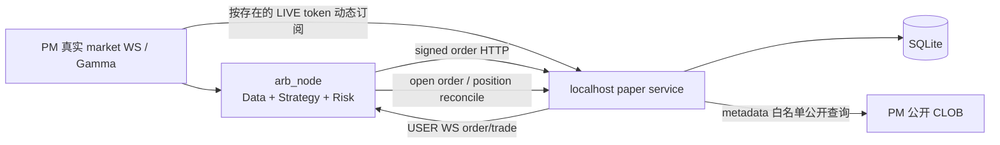

# Paper Execution 详细设计

> **定位**：本文是 Polymarket 本地 paper 交易机制的设计真理源。
> 选型理由和历史只记在 `docs/arbitrage/refactor.md`，配置字段只记在
> `architectures/_cross-cutting/configuration.md`。

## 1. 目标与边界

Paper 模式不绕过 NautilusTrader 执行链，也不把伪造持仓写进 NT Cache。
它用本地服务替换 **Polymarket 私有执行服务端**，让现有
`PolymarketExecutionClient` 继续负责签名、提交、USER WS 回执、账户状态、
Risk、Portfolio 和周期 reconcile。

| 路径 | paper 模式的数据源 |
|---|---|
| PM discovery / Gamma | 真实公开服务 |
| PM market WS / OBD | 真实公开服务 |
| PMSPORTS / OE / SE data | 原配置的真实数据源 |
| PM order/cancel/open-orders/trades/balance/positions | 本地 paper 服务 |
| PM USER WS | 本地 paper 服务 |
| merge/redeem/claim | 强制关闭 |
| OE/SE execution client | 按原配置注册；paper 不改变其它 venue 的运行行为 |

本地服务只允许绑定 `127.0.0.1` 或 `localhost`；它不校验 API 签名，
因此不能暴露到局域网或公网。

## 2. 组件与数据流

- `launchers/polymarket_paper_server.py`：独立进程入口，先于 arb node 启动。
- `PolymarketPaperExchange`：HTTP/USER WS 协议、订单状态机和 Market WS 逐帧撮合。
- `PaperStore`：SQLite 权威账本，持久化订单、成交、现金和仓位。
- 原 `ArbPolymarketExecutionClient`：连到本地 HTTP/USER WS，其余生命周期不变。

PM SDK 使用进程级共享 HTTP client，DataClient 与 ExecClient 不能各自设置一套
transport。Paper 节点保留 `venues.polymarket.proxy_url` 作为共享 client 的默认真实 PM
出口，同时给 `http://127.0.0.1` 和 `http://localhost` 安装强制直连 transport；ExecClient
自己的 USER WS 与 Data API 也对 localhost 直连。这样真实 discovery/OBD/CLOB 读取仍按
配置走代理，本地私有执行不会误发往代理。Paper 服务访问真实 Market WS 和公开 metadata
时也显式复用同一个 PM proxy；未配置时直连，任何一层都不读取环境代理。

Paper 服务作为唯一执行真值，所以 NT 周期 reconcile 保持开启。
重启 arb node 后，open-order 和 position report 会从 SQLite 恢复到 NT；不会与
本地 Cache 造假发生双真值冲突。

## 3. 协议面

### 3.1 私有执行端点

服务实现现有 `py_clob_client_v2` / adapter 会访问的子集：

- `POST /order`, `POST /orders`；
- `DELETE /order`, `/orders`, `/cancel-all`, `/cancel-market-orders`；
- `GET /data/order/{id}`, `/data/orders`, `/data/trades`；
- `GET /balance-allowance`, `/positions`, `/closed-positions`；
- `POST /paper/order-metadata`（仅本地审计 metadata 回写）；
- `GET /ws/user` WebSocket。

本地订单 ID 是对完整 POST payload 的确定性 hash，重试同一 payload 是幂等的。
真实模式会在 POST 前索引 CLOB order hash；paper 模式必须等 POST 回执的
本地 ID 再建立 `client_order_id ↔ venue_order_id` 映射，避免两种 ID 冲突。

USER WS 发送 adapter 已有 schema 能解码的 `order` PLACEMENT/CANCELLATION 和
`trade` CONFIRMED 消息。HTTP 回执先于延迟的 WS 事件；即使 WS 抢先，
现有 ack waiter 也会等待 HTTP 建立 ID 映射。

真实 PM USER channel 可以在无订单/成交时长期没有业务消息；本地 paper USER WS 的 ping/pong
只证明本地连接存活。因此 paper ExecClient 禁用“业务消息静默 300 秒即重连”的 idle timeout，
仍保留底层 WebSocket 断线/错误后的正常重连。Live 模式继续使用原 300 秒判据。

签名后的 PM 请求本身不携带 NT Order tags。Paper ExecClient 在订单 HTTP 成功并取得
venue order ID 后，向本地 metadata 端点回写 `client_order_id/pair_id/opportunity_id/leg_key`、
`origin/intent`、instrument/outcome/selection role、下单比分及提交时间。该回写失败只告警，
不得把已经接受的订单改判为失败。SQLite 启动时以可空列原地迁移旧库；旧订单没有正面证据的
字段保持空，不能猜测。

### 3.2 只读公开代理

构单 SDK 会相对 `base_url_http` 查询 version/tick/fee/neg-risk/market metadata。
因为 paper 模式把该 base URL 指向 localhost，本地服务只白名单代理：

`/version`, `/time`, `/tick-size`, `/neg-risk`, `/fee-rate`,
`/markets-by-token/`, `/clob-markets/`, `/book`。

任何非白名单 GET 返回 404；任何私有写请求都没有转发真实 PM 的路径。
这些公开白名单请求按 `venues.polymarket.proxy_url` 访问真实 PM；matcher 的 Market WS 也
使用同一 proxy，避免 paper 服务与节点公开行情因出口不同而出现可达性差异。

## 4. 撮合与账本语义

V1 模型由真实 PM Market WS 的每个有效业务帧驱动，不复制 L2 队列：

- 新 token 下单前动态订阅并等待初始 book，避免用未知盘口接单；最后一张 LIVE 订单终止后退订；
- BUY 在 `best ask <= limit`、SELL 在 `best bid >= limit` 时全量成交；
- 提交当下已交叉记为 taker，成交价取当时真实对手 best quote；
- 已驻留订单被后续任一帧触及时记为 maker，成交价固定为该订单自己的 limit；即使下一帧
  立刻回撤，前一帧已经产生的成交也不会被漏掉或撤销；
- `bid <= 0`、`ask <= 0` 或 `bid >= ask` 的双边异常帧不更新撮合盘口；
- FAK/FOK/IOC 未立即交叉则撤单；
- post-only 提交时若交叉则拒绝；
- V1 不模拟排队位置、可见深度消耗或部分成交。

撮合路径不轮询 REST `/book`。该端点仍在只读公开白名单中，只为了兼容现有 SDK 的公开
查询；它不是 paper matcher 的行情源。

接单前预留未成交 BUY 的限价名义额和未成交 SELL 的仓位数量，
超出本地现金/仓位则拒绝。成交与订单终态、现金、成本和仓位在同一
SQLite 事务内更新。当前 paper 成交回执费率为 0；NT 仍会按 instrument
的费率语义处理收到的 fill。

市场元数据/盘口查询发生在异步网络等待中，随后必须在进程内 placement lock 下重新检查
幂等 ID 与可用现金/仓位并立即写入订单。锁内不做网络 I/O，保证并发 submit 不会同时看到
同一笔可用额并超额预占。

## 5. 启动、停止与重置

运行时依赖随 `polymarket` extra 安装：`py-clob-client-v2` 负责原有构单/签名，
`aiohttp` 负责 localhost HTTP/USER WS 服务；SQLite 使用 Python 标准库，无独立服务或
数据库包。已有全量开发环境无需额外手工安装，新环境应先同步 `polymarket` extra。

1. 在 `arb_config.json` 设 `execution.mode="paper"`。
2. 启动本地服务：
   `.venv/bin/python launchers/polymarket_paper_server.py --config arb_config.json`。
3. 确认服务已启动后，另一进程启动
   `.venv/bin/python launchers/arb_node.py --config arb_config.json`。

SQLite 文件默认是可恢复账本；`starting_balance` 只在新数据库第一次创建时生效。
`execution.paper.reset=false`（默认）时，服务重启继续使用原账本。设为 `true` 时，paper
server 每次启动、建立 SQLite 连接前删除 `database_path` 及其 `-wal/-shm`，随后以
`starting_balance` 创建空账本；该模式用于让一次运行与一次审计数据严格对齐。启动前必须
先停止旧 paper server，避免两个进程分别持有被删除前后的账本。该开关只影响 paper
本地账本，不改变真实 PM 行情、OE/SE execution 或 arb node。

回溯分析使用 `scripts/arbitrage_audit/export_paper_execution.py`，输出“订单明细”、
“Pair汇总”、“类型汇总”和“说明”四个 sheet；订单类型统一展示为 `origin/intent`。
旧版账本可先用 `enrich_paper_execution_from_log.py` 从 NT `OrderInitialized` 与 execution
session 映射回填，不匹配的字段仍留空。导出读取 SQLite 一致性快照，不把 Excel 作为账本真值。
如需撤单现场，先由 `audit_nohup_orders.py` 生成日志审计 JSON，再以 `--audit-json` 传给导出器；
导出器按 `client_order_id` 合并 `OrderCanceled` 前最近一次策略可见盘口和最近一条比分。
日志没有比分或盘口时字段保持为空，不用撤单后的状态倒推。
同一审计 JSON 也提供首次 `OrderFilled` 前最近一条比分和盘号；未成交订单对应字段为空。

## 6. 安全不变量

- `execution.mode` 只允许 `live|paper`，paper 要求 PM venue enabled。
- paper host 只允许 localhost，端口/初始余额 fail-fast 校验。
- `paper.reset` 默认关闭；显式开启时每次 paper server 启动都会永久清空旧本地账本。
- paper node 保留全部 enabled venue 的 ExecutionClient 与 DataClient，只替换 PM 私有执行端点。
- paper 跳过 geoblock 检查，但仅因私有执行目标是 localhost；公开数据路径不变。
- paper 无条件禁用 `PolymarketSettlement`，即使 cleanup 和真实链上凭证都存在。
- 原 action 级 `place_bets.simulation` 已删除。Strategy 始终产生真实 NT
  `ExecutionPlan`；是 launcher/execution 模式决定进本地服务还是真实 venue。

## 7. 验收边界

离线用例覆盖：真实 `py_clob_client_v2.ClobClient` 的 submit/open-orders/cancel/order/trades
协议往返、
可成交单的账本/USER WS/REST trade schema、驻留单由 WS 后续瞬时交叉且按自身限价成交、
FAK 未成交撤单、资金与仓位预留、并发预占、重试幂等、paper 路由、共享 PM proxy 下的
localhost 直连、异常交叉帧丢弃、paper USER WS 无业务消息不触发 idle 重连、其它 venue
execution 保持注册、settlement 强制关闭。

还需在不发真单的 paper 运行中验收专属日志链：HTTP submit → USER WS →
`PAPER_MARKET_WS` / `PAPER_MATCH` → `OrderAccepted/OrderFilled` → Cache/Portfolio → 周期
reconcile。仅有这条路径实际执行后，
才能声称完整 paper node 可用。
