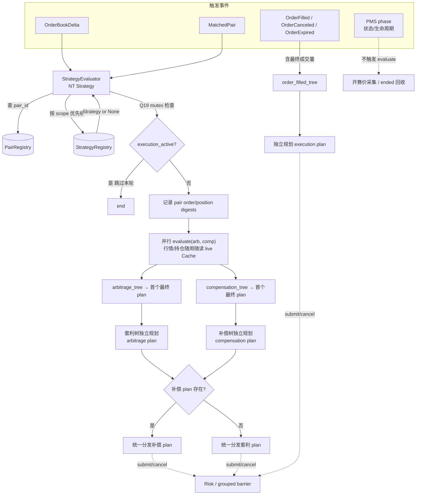
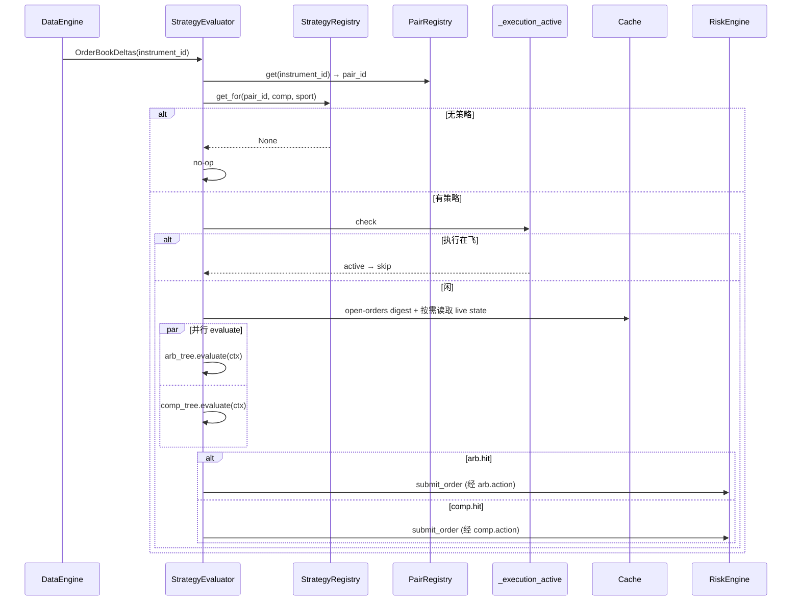

# Strategy 组件详细设计

> 设计理由 / 决策史(Q13/Q14/Q16/Q19/Q20 早期约束 + **Q21 框架锁定 2026-05-24**)见初设 `refactor.md §5.4 / Q21`。Q20 全状态快照已由 refactor #266 取代。
> 冲突时:有把握 → 以本文为准并回写;没把握 → 提出讨论。对应初设 Step 4。

---

## 1. 职责与边界

| 件 | 基类 / 角色 | 职责 |
|---|---|---|
| `StrategyEvaluator` | NT `Strategy` | 唯一运行时策略:行情事件驱动 arb+comp 树；订单完整成交或部分成交后的撤单/过期驱动可选 `order_filled_tree`；PMS phase 仅维护状态、开赛价与 ended 回收；所有订单经原生 `submit_order` |
| `StrategyRegistry` | 普通类 | 按 scope 索引策略;`get_for(pair_id) → Strategy or None`,按**挂载存在锁定**:具体比赛挂了就锁定本 scope,即使没命中也**不降级**(Q21-a) |
| `Strategy` | 领域 dataclass | `{ scope_key, arbitrage_tree, compensation_tree, order_filled_tree?, metadata }`；仅是配置树，不逐个注册为 NT Strategy |
| `Condition` | dataclass | `{ self_hits: BoolExpr, sub_conditions: list[Condition], checktion: CheckExpr, actions: list[Action] }` |
| `BoolExpr` / `StateQuery` | DSL | self_hits 的当前状态树；叶子读取 `EvalContext` 并可提交 per-eval scratch，支持事务式 AND/OR/NOT 嵌套 |
| `CheckExpr` / `Check` | DSL / abstract | checktion 的有副作用布尔树；`Check.passes(ctx) -> bool` 为叶子，支持 AND/OR/NOT 嵌套及 `scratch` 事务 |
| `Action` | abstract | `async Action.execute(ctx)` 由 Evaluator 按顺序 await |
| `EvalContext` | dataclass | 每轮评估上下文；Strategy 随用随读 live Cache，只冻结评估开始时的 pair order/position digests 并透传 Execution |

**职责边界(继承自前期锁定)**:
- ❌ **不引用 Risk**:透明拦截,strategy 只通过 `on_order_denied` 感知结果(§5.4)
- ❌ **不缓存待下单意图**:每轮全量重算(Q13)
- ❌ **不在策略层做 tp/sl/global 硬停**:归 RiskEngine(Q16)
- ✅ 设计参数与决策逻辑归本组件
- ✅ `self_hits` 只表达当前状态判定，不保存或更新跨轮策略变量；跨轮状态由自然归属组件维护

---

## 2. 数据流



要点:
- **OBD 触发(#357/#358,已落地)**:Evaluator 按 `(venue, binary_market_id)` 订阅
  `MarketOrderBookDeltas`；PM/OE/SE 都可触发。DataEngine 先写完同一 source 帧内所有
  二元市场的 inner OBD，再逐二元市场发布；Evaluator 只被当前 pair 的逻辑市场唤醒。
  旧 per-instrument callback 仅保留兼容，当前新订阅不经该路径。
- 生产求值使用异步 `evaluate_tree_to_plan`：叶子 checktion 通过后串行执行完整 Action 链，
  只有生成非空 submit 或 cancel_pair `ExecutionPlan` 才真正命中；否则回滚该分支 scratch 并继续兄弟分支。
  同步 `evaluate_tree` 仅保留为不执行 Action 的结构求值兼容入口
- arb / comp 两棵树 **真并行**(`asyncio.gather`)
- **树间取舍(#301)**在 Evaluator 统一分发阶段执行：两树各自完成门控、选择和计划构造，
  有补偿 plan 就选择补偿，否则选择套利。补偿树内部仍由 CheckExpr OR 的配置顺序决定
  `price_change_recovery` 与 `one_side_recovery` 的优先级
- order/position digests 不是对象快照；它们只用于 Execution release 前检测评估窗口内订单或
  仓位字段是否变化
- **订单成交终态树**不进入行情评估的 per-pair inflight gate，也不执行
  `is_pair_executing` 让路检查；它独立求值，但 Action 生成的计划仍通过同一个
  `dispatch_execution_plan` 出口进入 Risk、grouped barrier 与 ExecutionClient

---

## 3. 接口设计

### 3.1 `BoolExpr` + `StateQuery`(条件 DSL)

```python
class BoolExpr(ABC):
    @abstractmethod
    def eval(self, ctx: EvalContext) -> bool: ...

class StateQuery(BoolExpr):
    """叶子：每次只读取当前上下文。"""
    @abstractmethod
    def matches(self, ctx: EvalContext) -> bool: ...

class AndExpr(BoolExpr):  # 同 OrExpr / NotExpr
    def __init__(self, *exprs: BoolExpr): self.exprs = exprs
    def eval(self, ctx): return all(e.eval(ctx) for e in self.exprs)
```

`StateQuery` 与 `Check` 分开注册：前者只做当前状态判定并返回 bool；后者属于机会核查，可向
`ctx.scratch` 写本轮派生数据。框架不提供通用策略私有变量或恢复 SignalStore；确有跨轮语义时，
由该机制的专用 Store 维护并明确生命周期，例如 §3.8.4 的 `ConsecutiveTriggerStore`。

### 3.2 `Condition` / `CheckExpr` / `Check` / `Action`

```python
@dataclass
class Condition:
    self_hits: BoolExpr                        # 当前状态 guard
    sub_conditions: list["Condition"] = field(default_factory=list)   # 子组合互斥
    checktion: CheckExpr = field(default_factory=AndCheckExpr)         # 空 AND = 默认通过
    actions: list["Action"] = field(default_factory=list)              # 命中后按顺序执行

@dataclass
class EvalResult:
    hit: bool
    pending_actions: list["Action"] = field(default_factory=list)

class CheckExpr(ABC):
    @abstractmethod
    def eval(self, ctx: "EvalContext") -> bool: ...

class Check(CheckExpr):
    @abstractmethod
    def passes(self, ctx: "EvalContext") -> bool: ...

class AndCheckExpr(CheckExpr): ...  # 同 OrCheckExpr / NotCheckExpr

class Action(ABC):
    @abstractmethod
    async def execute(self, ctx: "EvalContext") -> None: ...
```

`CheckExpr` 与 `BoolExpr` 使用相同的 AND/OR/NOT 认知模型，但不能共用实现：
`StateQuery` 是纯查询，`Check` 会把
`legs/candidates` 等派生结果写入 `ctx.scratch`。
`CheckExpr` 因而规定以下事务语义：

- 所有节点同步执行，并按配置顺序短路，不并行调用 Check。
- Check 叶子返回 False 或抛异常时，回滚本叶子对 `scratch` 的修改。
- AND 任一子表达式失败时，回滚整个 AND；全部成功才提交所有顺序产物。因此
  `mean_rebate AND require_cross_venue` 的后者能读取前者生成的 legs。
- OR 的失败分支均从进入 OR 时的同一份 `scratch` 求值；首个成功分支提交并短路，
  后续分支不执行。
- NOT 只取反布尔结果，无论子表达式命中与否都丢弃其 `scratch` 修改。

### 3.3 `Strategy` / `StrategyRegistry`

```python
ScopeKey = Union[PairId, CompetitionName, SportName]   # 三种 scope,带类型

@dataclass
class Strategy:
    scope_key: ScopeKey
    arbitrage_tree: Condition
    compensation_tree: Condition
    order_filled_tree: Condition | None = None
    metadata: dict = field(default_factory=dict)

class StrategyRegistry:
    """按 scope 索引;查找按优先级 pair_id > competition > sport,
    **挂载存在锁定**(Q21-a):某 scope 挂了 = 锁定本 scope,即使没命中也不下放。"""
    def __init__(self):
        self._by_pair: dict[str, Strategy] = {}
        self._by_competition: dict[str, Strategy] = {}
        self._by_sport: dict[str, Strategy] = {}

    def register(self, strategy: Strategy): ...
    def get_for(self, pair_id: str, competition: str, sport: str) -> Strategy | None:
        # 严格按优先级,挂了就锁定,不降级
        if pair_id in self._by_pair: return self._by_pair[pair_id]
        if competition in self._by_competition: return self._by_competition[competition]
        return self._by_sport.get(sport)
```

### 3.4 `StrategyEvaluator`(NT `Strategy`,唯一运行时策略)

运行时算法 `evaluate_tree_to_plan` 是 `condition.py` 的模块级异步函数；同步 `evaluate_tree`
保留为结构求值兼容入口。两者与运行时 Strategy 解耦，Strategy 只做 orchestration：
open-order baseline / 两树 gather / plan 选择 / fire。

`strategy.enabled=false` 不卸载本 Strategy。原因是本 Strategy 还承担 `MatchedPair` 后
`_ensure_obd_subscribed` 的 OBD 订阅桥职责;卸载会让 PM/OE 盘口不进入 cache。禁用策略时,
配置 dispatcher 返回空 `StrategyRegistry`,Evaluator 仍订阅 OBD,但 `_route_eval` 查不到策略后 no-op,
因此不会评估条件树或触发 Action/submit。

```python
# condition.py(运行时入口；只生成计划，不提交或撤单)
async def evaluate_tree_to_plan(cond: Condition, ctx: EvalContext) -> EvalResult:
    before = deepcopy(ctx.scratch)
    if not cond.self_hits.eval(ctx):
        restore_scratch(ctx, before)
        return EvalResult(hit=False)
    if cond.sub_conditions:
        for sub in cond.sub_conditions:
            res = await evaluate_tree_to_plan(sub, ctx)
            if res.hit:
                return res            # 形成最终 plan 才命中并停止
        restore_scratch(ctx, before)
        return EvalResult(hit=False)
    if not cond.checktion.eval(ctx):
        restore_scratch(ctx, before)
        return EvalResult(hit=False)
    for action in cond.actions:
        await action.execute(ctx)
    if has_final_execution_plan(ctx):
        return EvalResult(hit=True, pending_actions=cond.actions)
    restore_scratch(ctx, before)
    return EvalResult(hit=False)      # 继续同级后续分支


# actor.py
class StrategyEvaluator(NTStrategy):
    def __init__(self, config, deps): ...   # deps: pair_registry / strategy_registry / portfolio /
                                            #       is_execution_active / loop

    def on_start(self):
        # slice 10d(#52):msgbus 直订 — NT `subscribe_data` 强制 SubscribeData cmd 路由(需 client_id/instrument_id);
        # MatchedPair 是组件间事件(MarketMatchingActor publish),走 msgbus broker。
        self._msgbus.subscribe(topic=f"data.{MatchedPair.__name__}", handler=self.on_data)
        # OrderBookDeltas 是 venue/instrument-tied,**slice 10d MVP 不预订**(MatchedPair 触发足以验全链路);
        # MatchedPair fire 后按 per-iid 订阅；概率校验通路按 matching 的 managed handoff 契约
        # 使用 managed=False，关闭校验时使用 managed=True 首次建立 book。
        # 只订 tradable_instrument_ids;PMSPORTS 等 non-tradable anchor 不订,旧 PM/OE 字段不作为 fallback。
        # SportsGameUpdate phase 按场经 NT subscribe_data 订阅，只维护状态/生命周期(§3.8.1)

    def on_data(self, data):
        # 1. _extract_evaluation_target(data) → (pair_id, sport, competition);MatchedPair 直读,
        #    其它 event 经 PairRegistry + instrument.info 反查
        # 2. 查 StrategyRegistry,有则 _create_task(self._evaluate_and_fire(strategy, pair_id))

    async def _evaluate_and_fire(self, strategy, pair_id):
        if self._is_pair_executing(pair_id): return    # §7.5(#316):本 pair 让路
        instrument_ids = self._pair_registry.instrument_ids_for_pair(pair_id)
        positions_digest = pair_positions_digest(self.cache, instrument_ids)  # #317:仅 position
        submitter = self._make_submitter()
        common = dict(
            pair_id=pair_id,
            cache=self.cache,
            pair_registry=self._pair_registry,
            sports_store=self._get_sports_store(),
            positions_digest=positions_digest,
            submitter=submitter,
            pair_order_canceler=self._make_pair_order_canceler(),
        )
        arb_ctx = EvalContext(**common)
        comp_ctx = EvalContext(**common)
        arb_res, comp_res = await asyncio.gather(
            self._aevaluate(strategy.arbitrage_tree, arb_ctx),
            self._aevaluate(strategy.compensation_tree, comp_ctx),
        )
        arb_plan = arb_ctx.scratch.get("execution_plan")
        comp_plan = comp_ctx.scratch.get("execution_plan")
        plan = comp_plan or arb_plan                    # 补偿优先
        if plan:
            await dispatch_execution_plan(plan, ...)    # 唯一执行副作用边界

    async def _aevaluate(self, tree, ctx):
        return await evaluate_tree_to_plan(tree, ctx)
```

#### 3.4.1 订单成交终态触发

`order_filled_tree` 是可选的第三棵 Condition 树，缺失时完全禁用。Evaluator 使用 NT 原生订单
回调，并以回调时 Cache 中已经应用后的订单为准：

- `on_order_filled`：只有订单状态已为 `FILLED` 才触发；`PARTIALLY_FILLED` 不触发。
- `on_order_canceled` / `on_order_expired`：只有终态订单的累计 `filled_qty > 0` 才触发，覆盖
  “先部分成交，后撤单/过期”的最终仓位。
- 同一 pair 生命周期内，同一 `client_order_id` 最多调度一次，避免完整成交后迟到撤单等重复
  终态再次执行树；pair ended 回收时一并删除去重集合。

NT ExecutionEngine 在发布订单事件给 Strategy 前已把 Order event 应用到订单 Cache，并已更新或
创建对应 Position；PositionOpened/Changed/Closed 的回调消息可以稍后发布，但树从 Cache 读取到的
订单与持仓已经是本次成交后的状态。

终态树直接创建自己的 evaluate task，不读取行情 `_pair_inflight`，也不因当前 pair 处于 execution
而跳过。任务计数只用于 ended 生命周期延迟回收 `PairPriceStore`，不承担门控。
其 `EvalContext` 额外提供：

- `event_name`：真实终态事件类名（`OrderFilled` / `OrderCanceled` / `OrderExpired`）。
- `trigger_event`：原始 NT 事件。
- `trigger_order`：事件应用后的 Cache Order。

树命中后仍只生成 `ExecutionPlan`；Evaluator 以 `source="order_filled"` 调统一 dispatcher，因而
不会绕过 Strategy 原生 submit/cancel、RiskEngine 或 Execution opportunity barrier。

`StrategyEvaluator` 的异步派发通过 `_create_task(...)` 统一处理:生产路径使用 NT kernel
`Actor.register_executor(...)`（`Strategy` 继承自 `Actor`）注入的运行 loop;`StrategyEvaluator.register_executor(...)` 先调用
NT 原生注册,再把同一个 loop 保存为 Python 侧调度指针。deps 注入的 `loop` 只作为未注册 executor
的单测 fallback。

> **⚠️ 本段原文(2026-06-30 ~ 2026-07-22)把两个不同问题混写成一条,已按 #260 拆开。**
> 旧文写"`on_data` 不保证处于 asyncio task 内,所以不能把 `get_running_loop()` 当作调度入口;
> 若当前 running loop 正是注册 loop 直接 `create_task`,否则 `call_soon_threadsafe` 投递",
> 读起来像"那条 fallback 是为下面那次事故写的"。实际是两件事:

| | 问题 | 状态 |
|---|---|---|
| **A** | **loop 身份取错** —— `add_actors()` 在 `node.run()` 之前捕获的 loop 不是节点实际运行的 loop,协程投上去永不执行 | **真实事故**(见下段),由 `register_executor` 解决 |
| **B** | **当前不在该 loop 上** —— 需要跨线程投递 | **未证实的假设**,#260 已删除该分支 |

A 已由 NT 保证:`kernel.py` 在 `start_async()`(本身已跑在 kernel loop 上)内调 `_register_executor()`
→ `actor.register_executor(self._loop, ...)`,拿到的就是真正运行中的 loop。因此 `_create_task`
只需 `loop.create_task(coro)`。

B 的 `call_soon_threadsafe` 分支 **#260 删除**,理由(同 `#105 ②`「无兜底猜测」纪律):
① 它返回 `Handle` 而非 Task,挂不了 done-callback → pair 闸的释放会静默失效;
② 它把"协程会不会跑"变成模糊态,导致在其上设计释放逻辑必然出错;
③ 真发生时 `loop.create_task` 会响亮抛 `RuntimeError: Non-thread-safe operation ...`,
届时按实际成因解决,而不是预先用一条未经验证的分支把问题吸收掉。

`add_actors()` 在 `node.run()` 前装配 actor,不能把当时通过 `asyncio.get_event_loop()` 取得的 loop
当作 NT 实际运行 loop,否则会出现只打印 `Strategy evaluate scheduled`、但无
`Strategy evaluate result` 且 `PairInFlightGate` 一直占用的症状(即上表问题 A)。

#### pair 闸的所有权出口(#260,2026-07-22,已落地)

**加锁与释放同层对称** —— 闸在 `_dispatch_eval`(OBD 回调同步段)置位,由**同一函数挂的
done-callback `_on_eval_done` 唯一释放**;`_evaluate_and_fire` 不再持有闸的知识,只返回
(#261:不再返回 `handed_off`)。闸机制本体见 `_cross-cutting/synchronization.md §7.3`;
全局 ≤1 执行见同文 §7.5(barrier 单点 + 纯派生态)。

```python
def _dispatch_eval(self, pair_id, ...):
    if not self._pair_inflight.try_enter(pair_id):        # 置位
        return
    coro = self._evaluate_and_fire(strategy, pair_id)
    try:
        task = self._create_task(coro)
    except Exception:
        coro.close()
        self._pair_inflight.release(pair_id)             # 排程失败:协程从未排程 → 释放安全
        raise
    task.add_done_callback(partial(self._on_eval_done, pair_id))   # 唯一释放点

def _on_eval_done(self, pair_id, task):
    # #261:无条件释放 —— 闸只保证"同 pair 不并发评估",没有跨组件交接,就没有可漏的判据。
    if not task.cancelled() and task.exception():
        self._log.error(...)          # 否则 fire-and-forget 异常被静默吞掉
    self._pair_inflight.release(pair_id)
```

**#261:释放是无条件的。** `_on_eval_done` 不再判断"有没有下单" —— 闸只保证「同一 pair 不并发评估」,
评估 task 结束就释放。#260 的 `handed_off` / `submitter.submitted_count` 交接判据**已删除**:
跨组件传递所有权才需要判据,而判据会漏(`#105 ②` 就漏了「action 链零提交」一态)。
**全局 ≤1 执行**改由 `ArbLiveExecutionEngine` barrier 用纯派生态保证,见
`_cross-cutting/synchronization.md §7.5`。

`await self._execute_actions(...)` 保留(原为 `create_task`):让 action 链的异常落进本 task,
由 `_on_eval_done` 带 traceback 打出来,而不是变成无上下文的 asyncio
"Task exception was never retrieved"。代价核对过为零 —— 本方法本就在自己的 task 里,
await 不阻塞别的 pair、不阻塞 loop(actions 内部本就顺序 await)。position digest 作为不可变字符串
随 ctx 活到 actions 结束并写入每条 order metadata（#317:open-orders-digest 已删）。

`is_execution_active` 前置检查保留,但 **#261 起只用于省算力**(避免明知会被 barrier 拒还去评估),
**不承担正确性**。用户明确不把 barrier ctx 纳入该判据:执行刚起步的那 ~2s 内仍会评估、
多几条 deny 日志,属吞吐/降噪取舍。

`StrategyEvaluatorConfig.log_evaluations=True` 时,评估器只增加 INFO 级低噪声运行锚点日志,不改变决策语义:
`Strategy evaluate scheduled` / `Strategy evaluate skipped` / `Strategy evaluate result` /
`Strategy action fired|skipped`。该开关用于 NT-node smoke 中确认 `OrderBookDeltas` 是否真的触发了
strategy evaluate,默认 `False` 保持生产路径安静。`Strategy evaluate scheduled` 额外携带调度时刻该 pair
全部 tradable legs 的 `order_books` 数组；每腿记录 `venue/outcome/best_bid/best_ask`，按底层
instrument id 排序，缺 book 或单侧顶价时写 `None`。这里只记录策略实际读取的 top-of-book，不展开
整本深度，避免高频评估日志无界膨胀。

### 3.6 消息接线

| 类 | 接收 | 发布 |
|---|---|---|
| `StrategyEvaluator` | 行情机会:`OrderBookDeltas` / `MatchedPair`；订单终态:`OrderFilled` / `OrderCanceled` / `OrderExpired`；状态通知:NT per-(game,phase) `SportsGameUpdate` | `submit_order` / `cancel_order`（经统一计划出口与 Risk/barrier）|
| `Action` 类 | (无订阅) | `submit_order` / `cancel_order`(NT 标准 client 接口)|

### 3.7 StateQuery/Check/Action 类型注册 + JSON loader

`StateQuery`、`Check`、`Action` 都是 ABC，具体类由 launcher 注册。三类 registry 分离：
状态查询不能复用会写 `scratch` 的 Check。

```python
register_state_query(name: str, cls: type[StateQuery])
register_check(name: str, cls: type[Check])    # 同名异类 raise(防误覆盖)
register_action(name: str, cls: type[Action])
build_state_query({"type": name, "params": {...}})
build_check({"type": name, "params": {...}})   # → cls(**params);未注册/参数错 → StrategyConfigError
build_action(...)                              # 同上;旧 action share 等未知参数 fail-fast
```

**JSON loader**(`src/arbitrage/strategy/json_loader.py`):递归解析 + registry 装配。

```python
bool_expr_from_json(spec)        # StateQuery spec 或 {"AND"|"OR"|"NOT": ...} → BoolExpr
check_expr_from_json(spec)       # Check spec 或 {"AND"|"OR"|"NOT": ...} → CheckExpr
condition_from_json(spec)        # 递归 sub_conditions / checktion / actions
strategy_from_json(id, spec, scope_key)  # 组装 Strategy
build_strategy_registry(cfg.strategy)    # bindings → StrategyRegistry
```

**缺值兜底**(Q21 必填字段):
- `self_hits` 缺 / None → `AndExpr()`(空 AND = vacuous truth,让下游决定 hit)
- `checktion` 缺 / None / `{}` → `AndCheckExpr()`(空 AND，默认通过)
- `compensation_tree` 缺 / None → 永 False no-op `Condition(self_hits=OrExpr())`(空 OR,从不 fire)
- `order_filled_tree` 缺 / None → 禁用订单成交终态触发；存在时按普通 `Condition` 递归解析

**scope 字符串格式**:`pair:<id>`(或别名 `pair_id:<id>`)/ `competition:<name>` / `sport:<name>`。
loader 解析前缀 → 调对应 `register_pair/_competition/_sport`。

**配置驱动 vs 代码硬编码**(#41 Q25 决策):配置驱动允许用户在 JSON 里递归组合
Condition 树,Q21 框架的"参数 first-class"特性配合 registry 实现了真正的运行时 wiring。
**dispatch 路径**:`to_strategy_registry(cfg)`(`config/dispatcher.py`)。`strategy.enabled=false`
时 dispatcher 返回空 registry,保留 OBD 订阅桥但禁用策略 Action。

### 3.8 per-eval scratch + live state 查询 + 用户域 Check/Action

具体策略需要 Check 算 derived 数据交给 Action 下单；状态查询则必须读取状态自然归属方的当前数据，
不在 Strategy 内复制一套跨轮状态。

| 数据类型 | 例子 | 落点 | 隔离 |
|---|---|---|---|
| 同 condition 树内 Check→Action 传值 | mean_rebate 算的 legs | `EvalContext.scratch: dict` | **per-eval 自动**(每次 evaluate 新建 ctx)|
| 当前状态查询 | PMS 比赛状态、订单、持仓 | `StateQuery.matches(ctx)` 从 `EvalContext` 读取其自然归属 Store/Cache | 由自然归属方的 `pair_id` / `game_id` 查询键隔离 |

**live state 契约(#266)**:
- `EvalContext` 持 `cache / pair_registry / sports_store`,Check/Action 在实际使用点读取当前
  order book、instrument info、position 与 instrument constraints，不再复制整个 pair 状态。
- 所有 binary pair 的经济 outcome 固定为 `["yes","no"]`。`claim` 是经济 outcome；
  `selection_role` 只用于匹配/展示。claim=no 的候选腿仍可带
  `lay_price` 与 `exec_instrument_id`，执行转换语义不变。
- 冻结项是 `positions_digest`（#317:open_orders_digest 已删,承 #316 per-pair ≤1）:Evaluator 在评估开始时对 pair 全部可交易
  instrument 的 positions 取不可变摘要；Action 原样写入所有真实腿 metadata，
  Execution barrier release 前重算比较。跨组件协议见
  `_cross-cutting/synchronization.md §8.4bis`，摘要 helper 落点见 common architecture §9。

**`EvalContext.scratch: dict`**:per-eval 自动隔离的 mutable scratch space。Check 算出的
derived 数据只给同树 Action 使用；套利树和补偿树分别拥有独立 `EvalContext/scratch`，禁止
跨树注入 candidate。每条命中链最终只能写本树 `execution_plan`；Evaluator 等两条链都完成
后读取两个 plan 做优先级选择。

**`EvalContext.pair_order_canceler`**:Evaluator 注入的同步回调。调用时重新读取
`PairRegistry` 下全部 instrument 的 live `cache.orders_open`，按 `client_order_id` 去重；
回调可选接收目标 `client_order_ids`，存在时只保留当前仍 open 的目标单，缺失时保持整个 pair 撤单语义。
随后为这一组订单生成共享 cancel opportunity metadata，并逐单调用 NT 原生
`Strategy.cancel_order(order, params=...)`。不保存 Check 阶段的可变 Order 引用，不调用 venue
私有撤单接口。命令先由 Execution 的共享 grouped-command barrier 按 cancel policy 收齐，再统一释放；PM/OE/SE 的
请求与终态确认仍由各自既有 cancel session 负责。横切协议见
`_cross-cutting/synchronization.md §8.4bis`。

**运行时默认参数(2026-06-29;2026-08-20 #355)**:`EvalContext.strategy_defaults` 每轮由 live `ArbitrageParams` 读取,但只包含 Check/Action 消费的 `share` / `max_leg_share`。`evaluate_on_depth_change` 由 Evaluator 在 OBD 调度入口直接消费，不进入 `strategy_defaults`；`fx` 只由 adapter 换汇边界消费。这些值来自顶层 `arbitrage` 配置段，Web 热改时经 `command.arb.arbitrage_params` 同步。strategy JSON 中 Check/Action 显式规模 params 优先于 Web 默认。边界原则：Condition/Checktion 产出带 `share_if_wins` 或 `qty` 的完整计划腿；Action 只做缩放、选择、提交。Strategy 内外 venue `qty` 统一为 USD stake，概率/qty/share-limit 分支按 Venue Registry `odds_model` 派生，真理源见 `_cross-cutting/venues.md §4/§5.4`。

**用户域子类(slice 9 #49 落地)**:

| 类 | 文件 | 用 |
|---|---|---|
| `MeanRebateCheck(min_rate, share=None)` | `src/arbitrage/strategy/checks/mean_rebate.py` | 从 live Cache 按 canonical `claim=yes/no` 分组并校验完整性；每个 outcome 取跨 venue 最低隐含概率后求 rate。decimal 概率换算与执行字段语义不变 |
| `OneSideRebateCheck(min_rate, share=None, one_side=True)` | `src/arbitrage/strategy/checks/one_side_rebate.py` | 从 live Cache 按固定 `yes/no` outcome 收集所有可买 leg，枚举 venue 组合与 target outcome；达阈值时写 `ctx.scratch["candidates"]`。`one_side` 缺失/`True` 保持定向分配；`False` 时仿照 `mean_rebate`，每个 outcome 都以 `arbitrage.share` 作为 `share_if_wins`，decimal qty 仍由 Venue Registry 按赔率反算。组合枚举与 one-side `min_rate` 公式不变 |
| `OneSideRecoveryCheck(min_rate=0.01, min_repaired_rebate=-0.05, force=False, less=False, current_position=False)` | `src/arbitrage/strategy/checks/one_side_recovery.py` | 原子组合门：先按 `OneSideRebateCheck` 的全量 venue/target candidate 口径判断当前盘口是否存在满足比较方向的定向返水机会，命中后再执行 `MeanRebateRecoveryCheck`，把各 outcome 补到当前最大实际 share。`less` 缺失/`False` 保持原判据 `rate >= min_rate`；`True` 改为严格 `rate < min_rate`，等号不命中。`current_position` 缺失/`False` 时任一 target candidate 满足即通过；`True` 时只比较当前最大持仓 outcome 对应 candidate 的 one-side rate，rate 仍完全使用当前两边盘口，不以开仓成本替换持仓方向价格。前置单冲检查使用隔离 scratch，只提交“命中”事实与满足方向的 candidate 数，不向 action 链泄漏 `candidates`；最终只输出 recovery `legs`。`min_repaired_rebate/force` 沿用 mean recovery 语义；`force` 只旁路 recovery 的当前率/补后率门，不旁路 `min_rate/less/current_position` 比较。补救腿固定采用 mean recovery 默认的跨 venue 最优价选择；费率默认包含 realizedPNL，不开放 `venue_select/pnl` 参数。 |
| `NegRebateCheck(max_rate=0.0)` | `src/arbitrage/strategy/checks/neg_rebate.py` | one_side_rebate 之后的候选方向门控：读取 Portfolio 的 `outcome_exposures/outcome_shares`，以各 outcome 聚合后的最大 share 为共同分母计算当前 rebate；按每个 candidate 的 `target_role` 过滤，只保留该 outcome 满足 `net_profit / max_share <= max_rate` 的 candidate。默认阈值为 0；无仓位时各 outcome rebate 视为 0，因此默认可通过。缺 candidates、Portfolio、完整 yes/no outcome 或经济投影异常时 fail-closed。只判断当前仓位，不预测加入 candidate 后的结果 |
| `RequireCrossVenueCheck()` | `src/arbitrage/strategy/checks/cross_venue.py` | 套利树过滤器:放在 `mean_rebate` / `one_side_rebate` 之后。若 `ctx.scratch["legs"]` 全部来自同一 venue,清空 legs 并返回 False;若 `ctx.scratch["candidates"]` 存在,过滤掉“candidate 内所有腿同 venue”的 candidate,剩余为空才返回 False。补偿树/recovery 可能天然单腿,不要放这个 Check |
| `MeanRebateRecoveryCheck(min_repaired_rebate=-0.05, venue_select=False, force=False, pnl=True)` | `src/arbitrage/strategy/checks/mean_rebate_recovery.py` | 从 live Cache 的 open positions 计算每个 outcome 的实际 share,**补单目标位**为最大实际 share;当前/修复后 rebate 的净利润基线读取 Portfolio outcome exposure,包含 Data API 对账恢复的 SELL/merge 已实现盈亏;对缺口 outcome 选补救腿写 recovery legs。**rebate 费率分母(#321)** = arbitrage `share`(读 `strategy_defaults["share"]`,不单设 Check 参数);分子含 realizedPNL,故分母用固定意向 share、不用波动的在场 share(理由见 refactor #321),取不到/≤0 则 fail-closed。**`venue_select`**:缺省/`False` 保持现状(各 venue 按 `(prob, venue_preference_rank)` 取最优赔率);`True` 时只在 PM 里选,某 outcome 无 PM 报价则该 role 缺席 → `roles_present` 校验 fail-closed(不补)。position outcome/金额统一委托 venues §4.1。**`force`(#326)**:缺省 `False` 保持 #262 双向率门(当前率 < 阈值才补、补后率 ≥阈值才算有用);`True` 时**旁路这两道率门**,只要存在缺口 outcome 就无条件补到 `target_share`(供 pre_rebate 开赛兜底强平衡,见 §3.10)。仅设很低的 `min_repaired_rebate` **不能**达到强补效果——#262 前置门 `current >= 阈值` 反而会拦住。**`pnl`(#327)**:缺省 `True` 保持 #321(补后率分子含 realizedPNL);`False` 时经 `outcome_exposures(..., include_realized_pnl=False)` 取基线,**当前率/补后率均不含 realized**,只按当轮开仓投影判率(供 pre_rebate 循环开平防即买即卖,见 §3.10;不影响 `target_share`/denom)。 |
| `PriceChangeRecoveryCheck()` | `src/arbitrage/strategy/checks/price_change_recovery.py` | 本轮由 OBD 唤醒且该 pair 当前至少有一张 open order 时，写 `cancel_pair_orders` 并生成整组撤单 plan。Check 接受现行 `MarketOrderBookDeltas` 与兼容 `OrderBookDeltas` 两种 `event_name`，不读取/比较 momentum；价格帧过滤由 Evaluator 入口的 `arbitrage.evaluate_on_depth_change` 统一负责。默认 `false` 时能进入 Check 的 OBD 已是真实顶价变化；显式 `true` 时纯深度 OBD 也会进入并触发撤单。MatchedPair/sports 等其它 `event_name` 不命中。无参数 |
| `SpreadCancelRecoveryCheck(spread)` | `src/arbitrage/strategy/checks/spread_cancel_recovery.py` | 遍历该 pair 的 open orders，逐单直接读取其自身 instrument 的 live OrderBook：BUY 取 best bid，SELL 取 best ask；订单价与盘口价均换算到该 instrument 的同一概率口径后计算严格 `< spread` 的概率差。它不按 outcome exposure 改写 side/instrument，因此能覆盖 `place_bets` 根据 PM 互斥库存动态生成的 SELL。命中时写标准 `legs + cancel_pair_orders`，随后仍完整经过补偿树 `candi_select -> place_bets`：前者做树内门控，后者生成 `cancel_pair` plan；不在 Check/Action 中旁路撤单 |
| `LowerTierCheck()` | `src/arbitrage/strategy/checks/lower_tier.py` | 复用 `competition_tier.lower_tier_oe_competition`，只读 pair 的 OE instrument 原始 `competition_name`；名称包含 Challenger/WTA/UTR/ITF（大小写不敏感）才命中。缺 OE 腿、缺原始名称或只在归并后的 `info["competition"]` 出现标记均 fail-closed；与 `venue_replace.tier_ignore` 共用同一赛事分级真理源 |
| `StartPriceBelowCheck(price)` | `src/arbitrage/strategy/checks/start_price_below.py` | 要求 `PairPriceStore.start_price` 完整覆盖 outcomes，筛选严格 `< price` 的 outcome 并选唯一最低价；最低价并列、无合格价、缺 PM instrument/有效 share 均 fail-closed。产出一条 PM BUY，`price/prob` 固定为记录的 start_price，`qty/share_if_wins` 使用 `arbitrage.share`；阈值等号不命中，`price` 必须为 `(0,1)` 内有限数 |
| `PreGameOrderCheck(offset)` | `src/arbitrage/strategy/checks/pre_game_order.py` | 要求 yes/no 两边 PM 实时 ask 完整且不相等，选择 ask 唯一较低的 outcome，按其当前 ask `×(1-offset)` 生成 PM BUY；不读取 first_price，不设绝对价格阈值。缺/重复 PM 报价、ask 相等、缺 instrument/share 均 fail-closed；`offset` 须为 `(0,1)` 内有限数 |
| `PreGameReverseCheck()` | `src/arbitrage/strategy/checks/pre_game_reverse.py` | 只消费前置 `exposure_source(source=pre_game_order,position_order=false)` 写入的非空 `cancel_candidates`，缺输入 fail-closed。候选中已 `SUBMITTED` 的 BUY 按自身 claim、SELL 按互补 claim 还原经济买入方向，全部订单必须指向同一 outcome。仅当订单经济方向的当前 PM ask 严格高于对手 ask，即已不再是最低方向时，写带候选 `client_order_ids` 的定向撤单请求；ask 相等、缺/重复 PM 报价、无单或方向混杂均 fail-closed。撤单后下一轮重新选择当前最低 ask，不保存额外反转状态 |
| `SelectOrdersCheck(position_order=None, origin=None)` | `src/arbitrage/strategy/checks/select_orders.py` | 旧策略配置兼容入口；仍可把订单来源/类型子集写入 `cancel_candidates`，但现行 `arb_config.json` 不再引用。新配置由 `ExposureSourceQuery` 在 condition 层完成筛选，避免 condition 只路由、checktion 再重复扫描 |
| `OrderCancelCheck(book_side="ask", price_drift=None, game_drift=None, min_tp_set=None, min_sl_set=None, force=False)` | `src/arbitrage/strategy/checks/order_cancel.py` | 统一撤单判定，只消费前置 condition `exposure_source`（兼容旧 `select_orders`）写入的非空 `cancel_candidates`。`force=true` 时不要求配置其它条件，并跳过盘口、commission、比分及盘数判断，无条件撤销候选集合中仍活动的订单；候选缺失/为空或候选已非活动订单仍 fail-closed，不退化为撤整个 pair。`force=false` 保持原语义：价格漂移、局数漂移和盘数不足均为 opt-in 且逐单 OR。`price_drift` 额外要求完整 PM yes/no 在 `book_side` 指定侧的概率和位于 commission 闭区间 `[0.98,1.02]`：ask 只校验 best ask，bid 只校验 best bid；缺腿、缺该侧报价、重复 outcome 或越界只关闭价格信号，不阻断其它 OR 信号。盘数门只能配置 `min_tp_set` 或 `min_sl_set` 之一；仅对 Cache 已绑定 position 且 `intent=recovery` 的平仓单生效，并分别读取 TP/SL 独立的 pair 运行时覆盖，缺覆盖才用配置值。两种盘数参数并存 fail-fast；`force` 非 boolean fail-fast；单项数据缺失只关闭该信号 |
| `PositionCloseCheck(origin=None, min_tp_set=None, min_sl_set=None)` | `src/arbitrage/strategy/checks/position_close.py` | 把目标 PM LONG Position 输出为同 instrument 的全量 SELL@best bid 平仓腿。盘数门只能配置 `min_tp_set` 或 `min_sl_set` 之一，分别使用独立的 pair 稀疏运行时覆盖，缺覆盖才取配置值；两者均缺失则跳过盘数检查，两者并存 fail-fast。当前盘号同时接受常规盘 `period=S<N>` 与抢七盘 `period=TB<N>`，其它格式仍 fail-closed。对应覆盖由 `advance_min_tp_set` / `advance_min_sl_set` 写入。其它仓位筛选和 fail-closed 语义不变 |
| `ExposureSourceQuery(source, position_order=None, magic=None)` | `src/arbitrage/strategy/queries/exposure_source.py` | 补偿树来源路由兼目标筛选。`source` 为 `pre_game_order/in_game_order/pre_game_position/in_game_position`；订单 source 可选 `position_order=true/false`，分别只留针对已有仓位的 SELL 单/普通单，还可用非空 `magic` 与订单冻结的 `arb:magic` 取交集；position source 配任一订单参数均 fail-fast。订单与仓位来源独立筛选：order source 扫 pair open orders 并按每张订单冻结的 `arb:origin` 输出 `cancel_candidates`；position source 不受 open order 存在与否影响，始终按 position 的 `opening_order_id` 来源输出 `position_candidates`。因此已有挂单不会阻止后续仓位分支提出替代平仓计划；同类/冲突订单去重由 `magic_order_gate` 负责，执行边界仍由 residual cancel-only 保护。空子集不命中且不污染 scratch；命中子集由下游撤单/平仓 Check 直接消费 |
| `MagicOrderGateAction(magic, conflicts=None)` | `src/arbitrage/strategy/actions/magic_order_gate.py` | 下单 Action 链的同类型去重门。扫描本 pair 全部 instrument 的订单历史，只要存在冲突 magic 且尚未终结的订单（包括 `INITIALIZED`、`SUBMITTED`、`ACCEPTED`），即清空本分支下单输出，不形成计划；已成交/撤销/拒绝/过期订单不阻塞。冲突集合始终包含主 `magic`，并与可选 `conflicts` 字符串列表取并集；因此省略 `conflicts` 完整保持原有“只拦同 magic”语义，显式列表用于增加其它互斥订单类型。无冲突活动单时只把主 `magic` 写入本轮 scratch，`conflicts` 不进入订单标签；后续 `place_bets` 复制到每条 submit spec，submitter 固化为唯一 `arb:magic`。缺 Cache/PairRegistry 时 fail-closed；`magic` 必须是非空字符串，`conflicts` 若存在必须是非空字符串组成的 JSON 数组 |
| `ShareLimitModification(max_leg_share=None, current_position_gate=False, current_order_gate=None)` | `src/arbitrage/strategy/actions/share_limit.py` | strategy 层 share limit 调整；单一 legs、candidate 缩放及 `current_position_gate` 语义不变。`current_order_gate` 为对象 `{enable, ignore_start_price}`：缺失或 `enable=false` 不读订单；`enable=true` 时经 pair 全量 `cache.orders()` 扫描订单，任一非终态订单（含 `INITIALIZED/SUBMITTED/ACCEPTED/PENDING_*/PARTIALLY_FILLED`）默认清空全部输出，`DENIED/REJECTED/CANCELED/EXPIRED/FILLED` 历史不阻塞。仅当 `ignore_start_price=true`、活动订单已经 `SUBMITTED` 且 `arb:intent=start_game` 时忽略它；尚未 submitted 的 `INITIALIZED` start_game 与其它 intent 活动单继续拦截。不再依赖订单价或 pair 历史 submitted 数量推断来源；旧 boolean 及 `spread` 字段不再接受，未知对象字段 fail-fast |
| `VenueReplaceAction(pm_price=None, convert=False, deviate_convert=False, attitude=False, tier_ignore=False, set_exempt=None, random_convert=None)` | `src/arbitrage/strategy/actions/venue_replace.py` | 显式 PM 定向执行动作：`tier_ignore=True` 时先经 PairRegistry 找到 pair 的 OE `BettingInstrument`，只读 venue 原始 `competition_name`（不读已归并的 `info["competition"]`）；名称包含 `Challenger`、`WTA`、`UTR` 或 `ITF`（大小写不敏感，普通 WTA 与 WTA 125K 均包含）即清空本树的 `legs/candidates/selected_candidate`，阻止该低级别赛事继续下单。缺 OE 腿、缺原始名称或非低级别名称时不命中；参数缺失或 `False` 完整保持既有路径。该 pair 级拦截优先于 `set_exempt`，不读取 `start_price`。旧 `tier_convert` 参数及 pre/post 反转语义已删除。未拦截时，对 `legs/candidates/selected_candidate` 中每条非 PM 腿按同一 canonical outcome(`yes/no`)替换为 PM 路由腿，decimal 合成 NO 的 `lay_price/exec_instrument_id` 不透传。`set_exempt=N` 在 Sports state 明确 `period=SN` 时禁用 `convert/attitude/deviate_convert/random_convert`，仍允许非 PM 腿默认同 outcome 替换；缺/坏 period 或盘号不等时不豁免。`convert=True` 只反转原生 PM 腿；未命中时，动态反转共同要求完整 PM best-ask 概率和位于 `[0.98,1.02]`，且原 outcome 同时存在有效 PM `best_bid` 与 `start_price`：`attitude=True` 命中 `bid <= start`，`deviate_convert=True` 命中 `1.2×start ≤ bid ≤ 1.3×start`。缺当前 outcome start/bid、动态参数缺失/`False` 或 commission 不合格只跳过动态反转，不拦截默认同方向 PM 替换。`random_convert=P`（有限数字且 `0≤P≤1`）在上述现有处理完成后，对每条未命中 `convert` 的最终腿独立抽样；命中即把最终 outcome 再反转一次，因此可反转 `attitude/deviate_convert` 的结果，但原生 PM 腿已命中 `convert` 时不抽样。缺失或 `0` 完整保持既有行为，`1` 对未豁免腿必定反转；命中 `set_exempt` 时同样不抽样，撤单计划也不抽样。`pm_price` 只控制未反转的非 PM 输入腿：缺失/`True` 用 PM best ask，`False` 沿用原腿 `prob`；任何规则或随机反转始终使用最终 PM token 实时 ask。PM `qty=share`，`price/prob/cost` 按所选价重算；缺目标腿、报价或 share 时 fail-closed。`tier_ignore` 与其余 boolean 参数只接受 boolean，`set_exempt` 只接受正整数；撤单计划不替换。推荐放在 `share_limit` 前 |
| `VenueSelectAction(pm=True)` | `src/arbitrage/strategy/actions/venue_select.py` | 按执行腿的 `venue` 逐腿过滤。`pm` 缺失或 `True` 时只保留 PM 腿；显式 `False` 时删除 PM 腿、保留其它 venue。支持 `selected_candidate`、`candidates`、legs-only 三种输入；候选池中的空 candidate 删除，元数据与撤单 candidate 保留，已选 candidate 同步更新 `selected_candidate["legs"]` 与 `scratch["legs"]`。`pm` 必须为 boolean。 |
| `CandiSelectAction()` | `src/arbitrage/strategy/actions/candi_select.py` | 每棵树独立执行：本树 `candidates` 优先，缺失时把本树 `legs` 包成单 candidate；逐腿按共享 `leg_plan` 做最小下注门控，再在本树幸存者中选择最大 leg share 最高者。它不读取另一棵树的 candidate，也不承担树间优先级 |
| `CommissionGateAction(commission | min_commission+max_commission)` | `src/arbitrage/strategy/actions/commission_gate.py` | 按 PM 二元盘口 commission 门控下单：commission 定义为当前 PM `yes/no` 两个 best-ask 隐含概率之和。旧单阈值口径保持为实际值 `< commission` 放通；闭区间口径在 `[min_commission,max_commission]`（含边界）内放通。两种配置互斥，缺任一 PM outcome/有效概率或超出范围时 fail-closed。支持 `selected_candidate`、`candidates`、legs-only 三种输入，候选池中撤单 candidate 原样保留，纯撤单输入 no-op。当前 `pre_rebate.in_game` 的 taker 路径（`place_bets.limit=false`）在 `candi_select` 后配置 `[0.98,1.02]` 范围门控。非 PM 报价不参与计算。 |
| `PriceGateAction(price, below=False)` | `src/arbitrage/strategy/actions/price_gate.py` | 按执行腿的统一隐含概率逐腿筛选；优先读取 Check 已写入的 `leg.prob`，缺失时经 Venue Registry `probability_from_price(venue, leg.price, claim/role)` 将 PM probability price 或 OE/SE decimal odds 转为 `0–1` 概率。默认删除概率 `< price` 的腿，`below=true` 时删除概率 `> price` 的腿，等于阈值均放通；无法得到有限且位于 `[0,1]` 的概率时 fail-closed。比较发生在 `place_bets(limit=true)` 改写最终限价之前；`venue_replace(pm_price=true)` 会把概率来源改成 PM 实时价，因此 Action 前后位置仍决定比较原候选概率还是替换后的 PM 概率。支持 `selected_candidate`、`candidates`、legs-only 输入，保留撤单 candidate；阈值必填且有限，`below` 必须为 boolean。 |
| `ConsecutiveTriggerGateAction(history_key, required_hits=2, limit=False, cross_set=False)` | `src/arbitrage/strategy/actions/consecutive_trigger_gate.py` | 仅接受 `OrderBookDeltas/MarketOrderBookDeltas`。从前序筛选后的腿提取唯一 canonical outcome 并读取完整比分；每次有效触发先按 `(pair_id, history_key)` 的旧历史判断，再无条件追加不可变事实快照，并记录本次门判定的 `passed`。同方向、相邻不同比分累计一次；同比分重复保留但不计数；最近出现相反方向即中断。当前盘为 `6-6` 或 `6-6(x-y)`（含 `0-0`）表示抢七进行中，本轮 fail-closed 且不写历史。达到 `required_hits` 放通，否则清空执行候选。`limit` 缺失/`None`/`False` 保持该既有逻辑；`True` 时增加经过局数约束。`cross_set` 缺失/`None`/`False` 时只扫描当前盘；`True` 时允许跨盘扫描并累计各盘常规局数。两种模式均不计抢七决胜局，并要求经过局数 `>= required_hits`。当前放在 `trend_gate` 后、比分筛选与 `price_gate/venue_replace` 前，因此历史表示趋势筛选后的原始价格信号，不因当时落后、打平或当前盘未领先而丢失；比分筛选仍决定本轮能否实际下单。参数 `history_key` 必须非空，`required_hits` 必须为整数且 `>=2`，`limit/cross_set` 非 boolean 时 fail-fast。详见 §3.8.4。 |
| `DashGateAction()` | `src/arbitrage/strategy/actions/dash_gate.py` | 只处理 `candi_select` 已选出的 `selected_candidate`：读取 `PairPriceStore.start_price`，按腿的 `claim`（缺失时 `role`）找到对应 outcome；若腿为 BUY 且 `leg.prob < 0.5 × start_price[outcome]`，从 candidate 中删除该腿，其余腿和 candidate 元数据保持不变，并同步写回 `selected_candidate["legs"]` 与 `scratch["legs"]`。等于阈值、SELL、缺 pair price、缺 outcome 或缺有效 `prob` 均保留，不凭不完整数据误删。撤单 candidate 不处理 |
| `TrendGateAction(up=True, complement=False, enable_flat=True)` | `src/arbitrage/strategy/actions/trend_gate.py` | 读取 live `PairPriceStore.trend_price` 与当前各 outcome 跨 venue 最低 best-ask 隐含概率，逐 outcome 直接比较：`current > baseline` 为 up，`current < baseline` 为 down，相等为 flat。`up` 缺失/`True` 留 up，`False` 留 down。`enable_flat` 缺失/`True` 时，某个 flat outcome 仅在其余所有 outcome 均为同一个非 flat 方向时推断成该方向的反面；二元 flat/down 因而视为 up/down，多 outcome 的对手方向不一致或仍含 flat 时不推断。显式 `False` 时只要完整趋势向量含 flat 就全删。`complement` 缺失/`False` 时各 outcome 独立过滤；显式 `True` 时，完整二元 outcome 的有效方向同为 up 或同为 down 会使本轮全删。它不恢复相邻帧 momentum、各 venue 同向或要求严格一 up 一 down，也无 `steps/trend` 参数。输入按 `selected_candidate` → `candidates` → legs-only 处理：已选 candidate 同步回写其 legs 与 `scratch["legs"]`；未选择的候选池逐 candidate 过滤 legs、淘汰空 candidate，并保留 rate 等元数据，供后续 `candi_select` 对过滤结果做门控与选择；mean/recovery 的 legs-only 则直接回写 `scratch["legs"]`，不凭空构造 candidate。基准、当前完整向量或 outcome 缺失时 fail-closed 全删。撤单 candidate 不处理。详见 §3.8.3 |
| `ScoreSelectionAction(standing=None, tie_break=True)` | `src/arbitrage/strategy/actions/score_selection.py` | 输入按 `selected_candidate` → `candidates` → legs-only 处理：已选 candidate 同步回写其 legs 与 `scratch["legs"]`；未选择的候选池逐 candidate 过滤 legs、淘汰空 candidate 并保留元数据；裸 legs 直接回写，不构造 candidate。`standing` 缺失时严格 no-op；显式配置时是以 `|` 分隔的 `win/draw/lose` 集合，例如 `win|draw`、`lose`、`win|draw|lose`，分隔符两侧空白与大小写不影响语义。状态只描述 instrument 对应参赛方，BUY/SELL 均使用同一目标腿状态，不因订单方向反转。Action 经 `PairRegistry.game_id_for_pair` 从 `SportsGameStateStore` 读取最新比分；逗号分隔的多盘比分先比较已完成盘胜数，盘数相同再比较当前盘。当前盘到 `6-6` 即进入抢七：`tie_break` 缺失/`True` 时忽略 `6-6(x-y)` 的括号小分，仅按常规局分 `6-6` 作为 draw；显式 `False` 保持既有语义，不比较抢七小分且整次判定 fail-closed。腿的实际参赛方从 live instrument `selection_role=home/away` 映射；PairRegistry 的字符串 ID 在进入 NT Cache 边界前统一转换为 `InstrumentId`。2-way pair 可直接映射，3-way 拆分 pair 的 `claim=no` 是复合结果，不能冒充相反一方，故无法确定的腿与缺比分/坏格式一起 fail-closed 删除。`standing` 非字符串、空段或未知值以及非 boolean `tie_break` 均 fail-fast；撤单 candidate 原样保留。**离线已验证，live-unvalidated（2026-10-23）** |
| `SetSelectionAction(standing=None)` | `src/arbitrage/strategy/actions/set_selection.py` | 注册名 `set_selection`。沿用 `score_selection` 的 `standing=win|draw|lose` 组合与目标 instrument 语义，但只统计已完成盘胜数，当前未完成盘的局分和抢七小分均不参与；尚无已完成盘时双方为 `draw`，比分缺失、格式非法或出现非末段未完成盘时 fail-closed。普通下单输入沿用 `selected_candidate`/候选池/legs-only 筛腿。若前序 `order_cancel` 已写定向撤单请求，则按 `client_order_ids → open Order.instrument_id → selection_role` 过滤撤单 ID；无符合 standing 的订单时删除撤单请求，使本叶不形成执行计划并继续 sibling。`standing` 缺失时严格 no-op。**离线已验证，live-unvalidated（2026-10-20）** |
| `CurrentSetGameSelectionAction(standing=None, tier_only=False, min=None, max=None)` | `src/arbitrage/strategy/actions/current_set_game_selection.py` | 注册名 `current_set_game_selection`，放在 `actions` 中。沿用 `score_selection` 的 standing 组合、目标腿与 BUY/SELL 无关的语义、`selected_candidate`/候选池/legs-only 三形态筛腿及撤单候选放通。仅比较最新一盘的局数，不看已完成盘胜数或 `6-6(x-y)` 的抢七小分，因此 `6-6` 与 `6-6(x-y)` 都按 draw；当前盘 `0-0` 表示尚无局分领先关系，不算 draw。若最新一段本身已构成完整盘（如 `7-5`、`6-4`、`7-6`），但下一盘 `0-0` 尚未到达，则当前盘不存在，按不可判定 fail-closed，不能拿刚结束盘冒充当前盘。`min/max` 均缺失时保持旧逻辑；配置正整数时，最新盘双方绝对局差须分别满足 `>= min` / `<= max`，两者并存要求 `min<=max`。`tier_only` 缺失/`None`/`False` 保持既有筛选；`True` 时复用 `competition_tier.lower_tier_oe_competition`，仅 OE 原始赛事名命中 Challenger/WTA/UTR/ITF 的低级别比赛执行本 Action，非低级别或无法确认低级别时直接放通。`standing` 缺失时严格 no-op；显式配置但比分/映射不可判定时 fail-closed 删除腿。参数非法时 fail-fast。**离线已验证，live-unvalidated（2026-10-16）** |
| `SameSetAction(limit=True)` | `src/arbitrage/strategy/actions/same_set.py` | 注册名 `same_set`，用于仓位平仓腿。Action 一经配置默认启用；`limit=False` 可显式 no-op。启用时逐腿按 `position_id → Position.opening_order_id → opening Order.arb:order_score` 取得仓位初始订单比分，并与当前 Sports 完整比分比较：盘数相同且此前各盘比分完全一致才视为仍在初始下单盘。只保留满足条件的腿；缺 position/opening order/下单比分/当前比分、坏比分或已经跨盘均 fail-closed。支持 `selected_candidate`/候选池/legs-only，撤单 candidate 放通；`limit` 非 boolean 时 fail-fast。**离线已验证，live-unvalidated（2026-10-16）** |
| `PmQuoteLegsAction()` | `src/arbitrage/strategy/actions/pm_quote_legs.py` | 纯报价产腿 Action：要求 yes/no 各有唯一 PM instrument 与有效实时 best ask，按 `arbitrage.share` 生成完整 PM BUY legs；不判断机会率、比分或最终订单价。通用报价产腿 Action，原用于 one-side miss 后的 fallback 链首位(该 fallback 已删除,当前配置不再引用),报价不完整时写空 legs，后续 Action 自然不产单 |
| `AdvanceMinTpSetAction(offset=1)` / `AdvanceMinSlSetAction(offset=1)` | `src/arbitrage/strategy/actions/advance_min_set.py` | 注册名分别为 `advance_min_tp_set` / `advance_min_sl_set`。命中对应撤单分支时只把本 pair 的 TP 或 SL 运行时阈值写为 `current_set + offset`，二者互不覆盖；`period=S<N>` 与 `period=TB<N>` 都取 N，缺 store/pair_registry 或其它盘号不可判定时不写。订单类型由上层 magic exposure 分支保证；`offset` 须为正整数 |
| `PreMoveCheck(move_threshold)` | `src/arbitrage/strategy/checks/pre_move.py` | pre_rebate 赛前追概率下行腿(#341/#361):读 `PairPriceStore.up_price/down_price` 与当前完整 PM best ask 向量。某 outcome 从历史最高价下跌比例 `(up-now)/up >= move_threshold` 时买它自身；从历史最低价上涨比例 `(now-down)/down >= move_threshold` 时买其互补 outcome。多信号同时命中取变化比例最大者，等于阈值命中；写单条 PM `BUY` leg(`qty=qty_from_share(PM, share, now)`)。当前向量和极值采样均必须满足 commission 闭区间 `[0.98,1.02]`；缺极值/完整腿、区间不通过、基准价非正或无变化达阈均 False。赛前/赛中门由 self_hits `in_game` 负责(§3.10) |
| `PlaceBetsAction(price_overrides=None, qty_overrides=None, intent=None, origin=None, spread=None, enable_timeout=None, market=None, limit=None, post_only=None, time_in_force=None)` | `src/arbitrage/strategy/actions/place_bets.py` | 名称为配置兼容保留，职责已收窄为**树内执行计划构造**。`intent=None` 时按树推导(补偿树 `recovery`、套利树 `arbitrage`)、`origin=None` 时按当前 phase 推导(`in_game`/`pre_game`,UNKNOWN 不写),显式值均覆盖推导,详见本节末 intent/origin 契约。若前置 `magic_order_gate` 已写本轮 magic，则原样复制到所有 submit spec。撤单意图生成 `ExecutionPlan(kind="cancel_pair")`；普通 legs 完成 side/price/qty、PM 库存减仓、spread/limit 定价、metadata 和资金需求转换后生成 `ExecutionPlan(kind="submit")`。输入腿若已携带 `position_id`，直接 SELL 计划必须原样传到 submit spec，由 NT 精确关闭该 Position。PM 目标 BUY 存在互斥 LONG 时优先转换为 SELL 既有仓位；当前暂不要求 SELL 互补参考价 `<= best bid`，缺 bid 或价格不交叉也继续转换，因此 SELL 可能只挂单而不立即成交。减仓量按现有 LONG Position 拆分，每条 SELL spec 携带对应 `position_id`，由 NT 原生 Position 生命周期关闭该仓位；无法取得 ID 或拆分后不满足单笔最小数量时不使用该库存。`limit=true` 时转换完成后每个最终 draft 的 BUY 取 `min(当前价, live best bid)`，SELL 取 `max(当前价, live best ask)`。`post_only=true` 写入 submit spec，由 submitter 构造 NT post-only GTC `LimitOrder`；缺失或 `false` 构造普通限价单。`time_in_force` 缺失时保持 GTC；显式 `"IOC"` 时构造 IOC 限价单，立即按限价或更优价成交并取消余量，不允许同时配置 `post_only=true`。PM adapter 在最终边界用官方 market builder 满足 FAK BUY makerAmount 两位精度，同时保留原限价；详见 execution §3.6。`market=true` 只写订单 metadata，最终市价转换同见 execution §3.6。Action 不调用 `submitter/pair_order_canceler`。最终计划由 Evaluator 统一选择和分发，现有 Risk、submit/cancel grouped barrier 与 adapter 不变。Paper 模式属于 launcher/execution 边界，不是 Action 分支 |

`mean_rebate`、`one_side_rebate` 与 `mean_rebate_recovery` 的行情候选腿统一由
`src/arbitrage/strategy/checks/quote_legs.py::quote_legs_by_outcome` 构造。⚠️ 2026-07-20/21
(#256)起,`best_ask(book)` 读到的直接就是隐含概率(decimal venue 的 book 写侧已按
`quote_claim` 换算,见 `docs/arbitrage/architectures/data/architecture.md` §2/§3.1),不再
在读侧二次调 `probability_from_price`;`leg["price"]`(真实下单价)经新增的
`to_price`(`price_from_probability` 的容错包装)从这个概率换算回来。Strategy 不再用
OrderBook 最深档覆盖计划价。市价意图由 `place_bets.market` 写入订单 metadata，
由 PM/OE/SE adapter 在最终服务端提交前完成 venue-specific 转换；详细契约见
`docs/arbitrage/architectures/execution/architecture.md` §3.6。
`claim/lay_price/exec_instrument_id` 透传只维护一份；三个 Check 只保留各自的组合与阈值算法。
Recovery 读取持仓时若发现 probability SHORT 等经济投影不变量错误,记录错误并放弃本轮；
ShareLimit 通过严格 Portfolio 读取持仓，遇到缺 claim 或 probability SHORT 时清空本轮
legs/candidates,不把未知敞口当成零继续下单。

**candidate action 链(2026-06-28;2026-07-31 #301 修订)**:`one_side_rebate` 等 Check 统一写
`ctx.scratch["candidates"]`。标准链路:
`share_limit -> candi_select -> place_bets`(arb 链);comp 链为 `candi_select -> place_bets`
(#277:comp 链也插 candi_select 使补救单同样过最小下注门控,但**不插 share_limit** ——
补救不受 `max_leg_share` 限制的现状语义不变)。两条链完全隔离；`candi_select` 只在本树内
门控和选择，`PlaceBetsAction` 只生成本树 `execution_plan`。树间补偿优先由 Evaluator 的统一
分发阶段实现，不改 submit/cancel barrier。
legs-only 的 Check(`mean_rebate` / `mean_rebate_recovery`)不必改写 candidates:
`candi_select` 对缺 `candidates` 键的 scratch 把 `legs` 包成单 candidate 走同一路径。

需要把执行 venue 强制定向到 PM、且在最小下注门控前先按语义收窄腿时，套利链显式使用
`venue_replace -> share_limit -> trend_gate/score_selection/current_set_game_selection -> candi_select -> place_bets`。
这些筛选 Action 都可逐个过滤尚未选择的 candidates；`candi_select` 因而只校验
最终可能执行的腿，避免将随后会删除的腿纳入整 candidate 最小下注门控。`candi_select` 之后仍可
组合只处理已选 candidate 的 `dash_gate`(开赛价断层过滤,读 `PairPriceStore.start_price`)。
**#329(2026-08-09)起
`one_side_rebate` 套利树用 `trend_gate` 替换了 `dash_gate`**(默认留概率变大的腿);两者都不进补偿树。
`venue_replace` 顺序不可后移到 `share_limit`
之后：替换会改变 venue，额度必须读取最终 PM 持仓。`venue_replace` 只转换执行腿，不重新执行
上游 Check，也不重算 candidate 的发现时 `rate/total_prob`；这些字段继续表示替换前机会。

`one_side_rebate` candidate 的 share 语义:`one_side` 缺失或为 `True` 时，非 target outcome 的
`share_if_wins=share`;target outcome 使用非 target 买完后的剩余预算全部买入，因此
`target_share_if_wins = target_cost / target_prob`。
例如 home=0.45、away=0.50、share=100 时,target=home → away 买到 100 share,home 用剩余 50
买到 111.11 share,rate=11.11%。`candi_select` 后续只看 share-limit 调整后的 candidate 内最大
`share_if_wins`,不依赖 `target_role`。
`one_side=False` 时，candidate 仍按上述 one-side 公式枚举 target 并执行 `min_rate` 门控，但数量
分配改为每个 outcome 都买到 `share`：各腿 `share_if_wins=share`、`cost=share×prob`；PM qty 等于
share，decimal venue qty 继续由 Venue Registry 反算，不能直接把 share 当 stake。

#### 3.8.1 PMSPORTS phase 状态消费与 live 状态读取(#250/#266/#387,已落地)

状态生产、订阅模型、Cache key、归零回收与错误边界的单一真理源在
`architectures/data/architecture.md §3.4.1`;本节只定义 Strategy 消费契约。

接线:

1. **按场订阅 phase 通道**:`MatchedPair` 到达时,gid 经 PairRegistry
   `game_id_for_pair(pair_id)` 反查(matching 注册先于发布,同步时序安全),
   `subscribe_data(sports_data_type(gid, SPORTS_CHANNEL_PHASE), client_id=PMSPORTS)`；
   同时自记 `game→OBD 腿` 映射。当前 Strategy 只消费 phase/ended，不订阅 score；无 gid 的 pair 静默跳过。
2. **phase 不触发机会评估**:PRE/IN_PLAY/POST 通知均不得进入 `_dispatch_eval`，避免在盘口没有
   新变化时复用旧 `trend_price` 生成订单。机会评估仍只由 OBD 价格变化与 MatchedPair 接线触发。
3. **事件 payload 只负责状态与生命周期定位**。PMS processor 已先写详细状态与聚合 phase；需要比赛
   阶段的 `StateQuery` 经 `ctx.pair_registry` 定位 game_id，再从 `SportsPhaseStore` 查询当前
   `PRE/IN_PLAY/POST`。`SportsGameStateStore` 只保留 PMS 完整比分/period 等详细状态。
4. **ended 释放**:ended 事件不评估策略，直接退订本场 sports 与该场各 pair 腿的 OBD
   (自记映射,不依赖 registry)→ 与 matching 侧退订汇合归零 → NT 收尾 + 内存回收
   (Store 条目、managed book;见 data §3.4.1)；若该 pair 已有评估 task，则沿用 pending-cleanup
   在 task 完成后删除价格与 runtime 状态。
5. Strategy 不冻结 sports state。PMS phase 与 OE/SE `inPlay` 都只更新状态，不绕过价格变化门控；
   后续正常 OBD 评估从 Store 读取最新 phase/score。

#### 3.8.2 PM 初始/开赛/极值价格采集(#323/#341/#364/#367/#404,已落地 · 离线已验证 · live-unvalidated · as-of 2026-09-28)

`StrategyEvaluator` 组合 PM OBD、PMS phase 与 PairRegistry，把 market-level pair 的
`first_price/start_price/up_price/down_price` 写入 Cache-backed `PairPriceStore`（Store schema/API 见 common §3.1）。
一个 3-way event 仍是 home/draw/away 三个 binary pair，每个 pair 按自身 `yes/no` outcomes
独立保存，不聚合成 event 级价格。

**初始化**：MatchedPair 到达且能经 PairRegistry 取得 `game_id` 时，按
`MatchedPair.outcomes` 幂等初始化；同时登记 `game_id → pair_ids`，该映射既用于 phase 扇出，
也避免 matching 先 unregister 后 Strategy 无法找到待回收价格。

**first_price**：仅 PM instrument 的 OBD 可触发。NT 已在回调前更新 managed OrderBook，
Evaluator 从该 pair 全部 PM instruments 读取每个 outcome 唯一且完整的 best ask 概率向量。
**仅 SportsPhaseStore 明确为 PRE 时采集；Store 无记录(`None`)=UNKNOWN，IN_PLAY/POST 也禁止采集**。
OE/SE `inPlay=false` 可在 PMS 赛前帧缺失时提供明确 PRE；`inPlay=true` 可在 PMS 首帧前
关闭 late-join 窗口。完整向量的概率和位于闭区间
`[0.95, 1.05]` 时整组首次写入；缺腿、重复 outcome、非法价格或区间不通过均保持空值。OE/SE OBD
只继续触发既有策略评估，不参与参考价采集。

> **UNKNOWN 取舍**：#367 取代 #364 的 `None=赛前`。系统宁可在所有源均未确认 PRE 时
> 不采 `first_price`，也不在 UNKNOWN 阶段执行赛前策略，不接受盘中 late-join 窗口的误判。
> 决策变更理由与历史仍保留在 `refactor.md #364/#367`。

**start_price**：有效 phase 为 IN_PLAY 时采集；PMS phase 消息按 game 扇出全部 pair，OE/SE
确认 IN_PLAY 后则在后续正常 OBD 价格内存回调中幂等尝试，且不强制触发策略评估。
仅当该 pair 已采到 `first_price`（= 见证过赛前盘口）且 `start_price` 仍为空时，读取当时
Cache 中完整 PM best ask 向量；仅当概率和位于闭区间 `[0.98,1.02]` 时整组首次写入。
phase 切换时缺完整 PM 盘口或区间不通过则保持空值；有效 phase 仍为 IN_PLAY 时，后续正常 OBD
继续幂等重试，直到首次取得合格向量，成功后不再覆盖。`start_price` 不提供默认兜底；DashGate 等消费者在其
为空时按缺数据处理，不得把占位价格用于策略判断。完整性校验使用独立的 `outcomes` 清单，
不再借用 `start_price` 的键集合。`capture_start` 首次写入成功后打印一次 INFO：
`Start price captured: pair=... game=... source=... prices=...`；重复尝试或缺少前置条件不打印。

**up_price/down_price(#341)**：每个 PM OBD 回调在路由评估前，读取该 pair 各 outcome 唯一且
完整的 PM best ask 概率向量；仅当概率和位于 pre_move commission 闭区间 `[0.98,1.02]` 才采样。
首个有效向量同时初始化两组极值，后续按 outcome 分别更新 `up=max(up,now)` 与
`down=min(down,now)`。本采集不依赖 Sports Store/`first_price`：`pre_move` 由 `pre_game`
限定下单阶段，极值内存只负责忠实记录有效行情。OE/SE OBD 不更新该字段。

**`first_price` 前置**：start price 只在 `first_price` 非空时采集，避免没有任何先行 PM OBD
见证就把首个 live 帧盘口直接当作开赛价。仅明确 PRE 时的干净赛前 PM OBD 可以构成该见证；
明确 live/ended 后到达的 OBD 仍不能补写 first price。

**释放**：ended 到达后仍先调度该场最后一次策略评估，并立即沿用 §3.8.1 释放 sports/OBD
订阅；价格记录进入 pending cleanup。Evaluator 按 pair 统计已排程 task，最后一个 task 的
done-callback 才 `delete(pair_id)` 并清 game 索引。无策略且没有在途 task 的 pair 立即删除，
保证不会在异步评估开始前先清 Cache。

#### 3.8.3 Pair 动态趋势基准(#356,已落地 · 离线已验证 · live-unvalidated · as-of 2026-08-21)

`StrategyEvaluator` 在每个 tradable venue 的 market OBD 回调中，从 live Cache 读取该 pair 全部报价，按
canonical outcome 分组。每个 outcome 使用与 `mean_rebate` 相同的最优价口径：取所有 venue 中最低
best-ask 隐含概率，相同概率按 `venue_preference_rank` 稳定排序。PM/OE/SE OrderBook 的 ask 已统一为
隐含概率，读取侧不得二次换算。

只有完整 yes/no 最优概率向量满足严格区间
`1 < Σ current_best[outcome] < 1.05` 时，Evaluator 才调用 `PairPriceStore.update_trend` 整组替换
`trend_price`；等于任一边界、缺 outcome、缺/非法报价或区间外均保持旧基准。基准更新发生在策略派发前：
正常无套利帧刷新后同轮比较为 flat；当最优概率和降到 `<= 1` 时基准冻结，策略用当前套利态报价与最后一个
无套利基准比较。首个完整有效向量即可初始化，不要求触发 instrument 已存在上一帧。

`trend_price` **不进入 EvalContext，也不随评估快照携带**。`TrendGateAction` 执行时按 `pair_id` 直接从
live `PairPriceStore` 读取基准，并用共享 best-probability helper 从 live Cache 重算当前向量。逐 outcome
判定：`current > baseline` 为 up，`current < baseline` 为 down，相等为 flat；默认不使用相邻帧 momentum、
跨 venue 方向一致或累计 `steps`。`enable_flat` 缺失/`true` 时，某个 flat outcome 仅在其余所有 outcome
都是同一个非 flat 方向时，视为该方向的反面；二元市场天然只需检查唯一对手，多 outcome 市场则要求
全部对手 trend 一致。对手方向混合或包含 flat 时不推断。`enable_flat=false` 时完整向量只要含 flat 就
fail-closed 全删。`trend_gate(complement=true)` 在 flat 推断后检查二元 outcome，同为 up 或同为 down 时
全删，其余情况再由 `up` 参数筛选目标方向。缺基准或不完整数据时 fail-closed。

**OBD 评估过滤(#355/#357)**：删除 momentum 后仍需区分真实顶价变化和纯深度帧，因此 Evaluator 只保留
内部 `_last_best_ask`，在 market 批次中比较所有变化 instrument 的前后 best ask；
它不计算趋势、也不向策略暴露。`evaluate_on_depth_change=false` 时仅至少
一腿真实变价的 market 帧派发，首帧/同价深度帧/无效行情不派发；`true`
时所有 market OBD 均可派发。ended 退订时清理 `_last_best_ask`，PairPriceStore
仍按 §3.8.2 的 pending-cleanup 时序整组删除。

Pair 价格内存更新使用同一 market topic 上 `priority=5` 的同步 MessageBus
handler，Strategy 普通 `on_data` 订阅保持 `priority=0`。该顺序只负责
`PairPriceStore(first/extreme/trend) → 策略评估`；订单簿整批先写完的保证由
DataEngine 批次契约提供(data §2.1)，不依赖 MessageBus priority 解决跨 instrument
中间态。`price_change_recovery` 接受 `event_name=MarketOrderBookDeltas`；旧
`OrderBookDeltas` 值仅为兼容通路保留。

**成熟度**：相关路径有离线用例覆盖；见 `test_pair_prices.py`、`test_price_trend.py`、
`test_action_trend_gate.py` 与 `test_evaluator.py`。决策史见 refactor #356。

#### 3.8.4 原始腿连续触发历史（#421/#423，已落地 · 离线已验证 · live-unvalidated）

`ConsecutiveTriggerStore` 是本机制的自然状态归属，不恢复已删除的通用
`StrategyRuntimeStore`。它在进程内按 `(pair_id, history_key)` 追加
`TriggerObservation`，记录触发时间、事件名、原始/规范化比分、venue_replace 前唯一 outcome、
候选 id/rate、每条腿的 instrument/venue/side/price/probability，以及本轮连续门是否真正放行的
`passed`。历史项不可变且不覆盖；
同比分重复也保留，供后续更复杂的时序策略读取。程序重启不恢复历史。

`consecutive_trigger_gate` 只在有效 OBD 评估中工作。它消费前序 Action 已筛出的
`selected_candidate/candidates/legs`：没有腿、仍有多个 outcome、缺 Sports state、空/坏比分或
Store 缺失，或当前盘处于裸 `6-6` / `6-6(x-y)` 抢七（包括 `6-6(0-0)`）时 fail-closed 且不写历史。
有效触发先扫描最近连续尾部：同 outcome 的同比分记录跳过，
每遇到一次比分变化增加一次 hit，遇到相反 outcome 立即停止；满足 `required_hits` 后放通本轮。
可选 `limit` 缺失/`None`/`False` 时不增加约束；显式 `True` 时增加经过局数约束。此时
`cross_set` 缺失/`None`/`False` 保持现有同盘语义：只扫描当前盘内最近连续同 outcome 历史，
遇到相反 outcome 或盘切换即停止，并以该盘 `(左局数 + 右局数)` 之差计算经过局数。
`cross_set=True` 时不因盘切换停止，取最近连续同 outcome 的最早不同比分触发，以完整比分中
各盘 `(左局数 + 右局数)` 总和之差累计跨盘经过局数。两种模式都要求该值 `>= required_hits`。因此
`required_hits=2` 时同盘 `4-3 → 4-4` 只有1局而不放行，`3-3 → 4-4` 已过2局而放行；
默认情况下第一盘 `5-4` 不能与第二盘 `0-1` 合并计数；开启 `cross_set` 后，`5-4 → 6-4, 1-0`
按2个常规局计算并放行。无论 `cross_set` 取值如何，抢七进行中的比分不产生触发历史，且
`6-6 → 7-6` 的抢七决胜局不计经过局数；总局数倒退视为不可比较并 fail-closed。`cross_set` 在
`limit` 未开启时不改变既有 hit 逻辑。
判定完成后无论通过与否都追加本轮并冻结 `passed`，因此被后续比分筛选、`price_gate`、`venue_replace`、Risk 或
执行层拦截不影响“该原始信号已经发生”的事实。连续性描述价格信号，不要求触发方向当时已经领先；
落后、打平或当前盘未领先的方向仍写历史，但本轮随后会被比分筛选阻止下单。

低级别赛中原先在 `one_side_rebate` 之外挂了一条 `consecutive_trigger_game_gap` fallback 叶子,
现已删除:one-side 未命中时不再有第二条独立下单路径。`one_side_rebate` 命中路径
(含 `consecutive_trigger_gate`)的 `place_bets` 改为 `limit=true` 且带 `spread`,即以
`min(ask, best_bid)` 为基价再下移 `spread`(概率口径)挂 maker 单,而非原先的即时成交。
`consecutive_trigger_gate` 仍记录并冻结 `passed`(见上),该字段现无 Check 读取、仅为留存事实。

当前 `pre_rebate` 顺序为
`trend_gate → consecutive_trigger_gate → score_selection → current_set_game_selection → price_gate → venue_replace`，
配置为：

```json
{"type":"consecutive_trigger_gate","params":{"history_key":"pre_rebate_original_leg","required_hits":2,"limit":true,"cross_set":true}}
```

`StrategyEvaluator` 持有唯一 Store 并经 `EvalContext` 注入。per-pair 评估闸保证同 pair 观察/追加串行；
比赛 ended/eviction 后沿用 PairPriceStore 的 pending-cleanup：若有在途评估，等最后一个 task 完成，
再由统一 pair 回收出口调用 `delete_pair(pair_id)`，防止“先删、旧评估后写回”。活动比赛期间不裁剪历史。

### 3.9 树内执行计划 + Evaluator 统一分发

**状态：已落地，2026-07-31（#301）。**

套利树和补偿树各自完成 Action 链并生成 `ExecutionPlan`。`PlaceBetsAction` 不产生执行副作用；
`StrategyEvaluator` 等两棵树都完成规划后，以 `compensation_plan > arbitrage_plan` 选择唯一
计划，再调用 `dispatch_execution_plan`。

**落地**:
- `ExecutionPlan(kind="submit")` 携带已定稿的真实 order specs；spread、intent、
  `enable_timeout`、实际 instrument/side/price/qty 均在所属树内确定，dispatcher 不重算。
- `ExecutionPlan(kind="cancel_pair")` 携带 pair/reason，可选携带目标 `client_order_ids`；缺目标时
  重读并撤销 pair 全部 open orders，存在目标时只撤当前仍 open 的目标单。胜出后才调用
  `pair_order_canceler`，两种形态都继续走现有 grouped cancel barrier。
- 同一树的 sibling 按配置顺序尝试；checktion 通过但 Action 链未形成最终计划不再占用命中位，
  该分支 scratch 回滚后继续下一 sibling。非空 submit 与 cancel_pair 计划都属于最终命中，随后停止。
  Action 写专用跨轮 Store 的行为遵循该 Action 自身契约，不属于 scratch 事务回滚范围。
- 补偿树命中但树内门控后没有 plan 时可选择套利 plan；一旦某个 plan 开始分发，本轮不再回退。
- 任一树 Action 链抛异常则整轮失败，不以套利 plan 绕过异常的补偿链。
- `EvalContext.submitter/pair_order_canceler` 仅供 Evaluator 最终分发使用，树内 Action 禁止调用。
- `make_submitter(*, cache, order_factory, submit_order, log)` module-level 工厂 → `async def submit(spec)`:
  1. `cache.instrument(iid).{size_precision, price_precision}` 拿精度
  2. PM instrument 带 `info.order_size_increment` 时，两侧 qty 都保留到该网格：SELL 向下取整避免减仓超卖，BUY 按 `ROUND_HALF_UP` 正常四舍五入。随后经 evaluator 的 NT `order_factory.limit(...)` 构 `LimitOrder`(`OrderSide.BUY/SELL` / `Quantity` / `Price` / `TimeInForce.GTC` / `ARB-*` ClientOrderId / opportunity tags)
  3. 调 evaluator 绑定的 `Strategy.submit_order(order, position_id=...)`；普通 BUY/无库存转换的订单省略
     `position_id`，PM inventory SELL 传入要关闭的既有 LONG Position ID。NT 原生发布 `OrderInitialized`、检查重复
     `client_order_id`、写 Cache，并构造 `SubmitOrder` 路由到 RiskEngine
  4. Risk pass 后进入 `ExecEngine`;Execution opportunity barrier 等齐本轮 legs 后才 release 到 venue
     ExecClient。横切协议见 `_cross-cutting/synchronization.md §8.4bis`。
- 原生 submit 写入 Cache 时订单仍为 `INITIALIZED`；NT `cache.orders_open()` 不把该状态计为 open，
  因此本次机会的新腿不会被 barrier 当成 residual（#317:barrier 已不做 open-order digest 校验）。
- **spec schema**:`{instrument_id, side: "BUY"|"SELL", qty: float, price: float, position_id?: str|PositionId, intent?: "arbitrage"|"recovery"|"start_game", opportunity_id?: str, pair_id?: str, leg_key?: str, expected_legs?: list[str], positions_digest?: str}`（#317:open_orders_digest 已删）。`position_id` 仅用于明确针对既有 Position 的订单；submitter 统一转为 NT `PositionId`。
- `instrument_id` 允许是策略 legs 使用的字符串视图,也允许是 NT 原生 `InstrumentId`;
  `make_submitter` 是边界适配点,统一转成 `InstrumentId` 后再调用 `cache.instrument(...)`
  和构造 `LimitOrder`。这是 Strategy 与 NT cache 的契约边界,避免 Action 层直接依赖 NT 标识对象。
- 冷启动安全:`cache.instrument(iid)` 返 None → warning + skip,不 raise

**PlaceBetsAction 规划边界**:
- 汇总日志为 `PlaceBets[prepare]`；只表示计划已构造，不表示订单已经提交。
- 只有统一分发器输出的 `ExecutionPlan[submit]` / `ExecutionPlan[cancel]` 才表示某个计划
  已被选中并开始执行；同轮未胜出的树可以有 `PlaceBets[prepare]`，但不会有执行副作用。
- `ctx.submitter is None` 时由 dispatcher 输出 `would submit`，用于 smoke。
- `PlaceBetsAction` 不再提供 action 级 `simulation`。需要模拟实盘时，Action 仍产生完整
  `ExecutionPlan`，由 `execution.mode=paper` 把 PM 私有执行路由到本地服务。因此
  Risk、barrier、Cache、Portfolio 和 reconcile 均会真实执行，见 paper architecture。
- size 计算优先级不变。decimal 合成 no 以 `exec_instrument_id != instrument_id` 判定并转 `SELL @ lay/bid`;逻辑 `claim=no` 本身不触发转换。转换/拆单后才建立实际 barrier legs。
- non-tradable guard:若上游误把 `.PMSPORTS` anchor 或其它 `tradable=false` / `anchor=true` leg 写进 `ctx.scratch["legs"]`,整次 opportunity fail-closed,不生成任何 submit spec。
- Action 参数覆盖(#88):`price_overrides={"ORBITEXCH": 1000.0}` / `qty_overrides={"ORBITEXCH": 7.0}` 只用于构造最终 submit spec,适合 live 验证“不成交挂单 → 下一轮 cancel-only”这类执行路径;`MeanRebateCheck` 仍用真实 OBD 的 best ask 计算机会与选择 venue,execution 仍透明执行传入订单内容。
- Action 限价价差(#293):`spread` 缺失或为 0 时不改变行为；设置后先按原计划价完成 qty
  计算及 PM 互斥库存拆单，再把每个最终 draft 的 venue 价格转成 YES 隐含概率，执行
  `BUY: probability-spread` / `SELL: probability+spread` 后反算 venue 价格，因此只改变
  限价、不改变既定 qty。调整后优先使用 instrument
  `min_price/max_price`；PM 未显式给边界时按 `[price_increment, 1-price_increment]`，
  decimal venue 未显式给边界时按 `[1.01, 1000]` 裁剪。`price_overrides` 先于 spread；
  资金需求按 spread 后的计划价格计算。若同时配置 `limit=true`，先按盘口完成 limit 定价及
  最终执行 instrument 重定价，再对每个最终 draft 应用 spread。decimal 分段赔率量化属于 Execution adapter 的最终
  payload 边界，不在 Action 重复执行。若本 Action 显式 `market=true`，Execution adapter 的最终
  市价转换可覆盖该限价；Action 仍保留原计划价格。
- Action ACK 收口参数(#298/#300):`enable_timeout` 必须是 JSON boolean；对 submit，缺失/`true` 保持
  等待终态或 watchdog 的既有行为；显式 `false` 时
  `PlaceBetsAction` 为同一 opportunity 的每条真实 submit spec 写该字段，submitter 经
  `OpportunityMeta` 写入 `Order.tags`。普通 cancel-only 不读取原订单该字段；只有补偿树
  grouped cancel plan 显式携带时，才通过 `CancelOrder.params` 传给 cancel session；
  Strategy 只声明策略，不直接结束 execution session。
- Action 市价参数(#325):`market` 必须是 JSON boolean；显式 `true` 时同一 opportunity 的每条
  submit spec 都写入该值，经 `OpportunityMeta` 进入 `Order.tags`。缺失或 `false` 不请求市价；
  Action 不改 price/qty，venue-specific 转换只发生在 execution §3.6 的最终提交边界。
- Action 盘口限价参数(#337/#348):`limit` 必须是 JSON boolean；缺失或 `false` 完全保持既有计划价、
  `price_overrides` 与 `spread` 行为。显式 `true` 时，按每个**最终执行 instrument** 的 live
  OrderBook 与当前计划价择优：BUY 取 `min(当前价, best bid)`，SELL 取
  `max(当前价, best ask)`；PM 库存转换仍先用互补参考价与 best bid 判断是否值得转换，
  生成的 SELL 子单随后与其自身 instrument 的 best ask 取较高者，故该模式不承诺立即成交。
  Cache 盘口统一存 outcome 概率，因此 Action 按 instrument
  `quote_claim` 经 Venue Registry 反算 PM/decimal venue 原生订单价。若配置 `spread`，在上述
  limit 定价完成后继续应用；
  `price_overrides` 若存在则构成“当前价”参与上述 min/max。显式 qty 保持不变，未给 qty 时按最终限价计算 share 对应
  数量。任一最终订单缺所需盘口侧、instrument 或价格非法时整次 opportunity fail-closed。
  `market=true` 的既有 adapter 最终转换语义不变。
- Action maker-only 参数(#352):`post_only` 必须是 JSON boolean；缺失时不写 submit spec，显式
  `false` 写入但同样构造非 maker-only `LimitOrder`，两者行为相同；TIF 由下述独立参数决定。显式 `true` 时每条
  submit spec 都携带该值，submitter 直接设置 NT `LimitOrder.post_only=True`；它不改变
  `price/qty`，也不替代 `limit` 的盘口定价。PM adapter 在单笔 REST 出站时把
  `order.is_post_only` 传给官方 CLOB SDK，见 execution §3.6。
- Action TIF 参数:`time_in_force` 缺失时保持 GTC；只接受 `"GTC"` / `"IOC"`（大小写不敏感）。
  `"IOC"` 构造带策略限价的 NT IOC `LimitOrder`，PM adapter 按既有映射发送 CLOB `FAK`：立即按
  限价或更优价成交，无法成交的数量立即取消。IOC 与 `post_only=true` 互斥并在配置加载时 fail-fast。
- `intent` 未显式配置时**按树推导**:compensation tree → `"recovery"`,arbitrage tree(及
  `tree_kind=None`)→ `"arbitrage"`。解析优先级:胜出 candidate 标记 > Action 显式配置 >
  按树推导(`ctx.tree_kind`,由 actor 在 arb_ctx/comp_ctx 分别置 `"arbitrage"`/`"compensation"`)。
  因此补偿树所有产单分支默认即 `recovery`,**包括原先漏标的 `one_side_recovery`/`price_change_recovery`
  OR 分支**(它们从此一并豁免 TP/SL profit gate,修正了"recovery 单却按普通单受 TP/SL 拦"的
  不一致)。B5 的 `"start_game"` 等特殊 intent 仍须显式配置(显式覆盖按树推导;当前配置未接入 B5)。
  submitter 写入 `arb:intent=<intent>`。Risk 仅对 `recovery` 跳过单场 profit gates(详见 risk §3.1)。
- `origin` 未显式配置时**按当前 phase 推导**:`phase_store` 该 game 为 `IN_PLAY`→`"in_game"`、
  `PRE`→`"pre_game"`、UNKNOWN(缺 game_id/phase_store/状态)→不写(与 `InGame`/`PreGameQuery` 同口径)。
  显式配置优先覆盖;显式非法值(非 `pre_game`/`in_game`)构造即 `ValueError`(抓 typo)。因下单分支本就被
  `self_hits` 的 phase 门控,推导值与分支语义一致,配置可省略 `origin`。写入 `arb:origin=<origin>`;
  订单分支直接读该标签,仓位按 `Position.opening_order_id → Cache.order → arb:origin` 追溯。详见 common §1。
- `magic` 不由 `PlaceBetsAction` 推导；只有前置 `magic_order_gate(magic=...)` 放行后才进入 spec，
  submitter 写为 `arb:magic=<magic>`。它只标识订单类型，不替代 `intent/origin`。
- **opportunity metadata(已落地代码,待 live 验证,2026-06-14)**:`PlaceBetsAction` 在同一次 `execute(ctx)` 内为所有真实 legs 生成同一个 `opportunity_id`,并为每条 spec 写 `pair_id=ctx.pair_id`、稳定 `leg_key`、`expected_legs`(所有真实腿 key,包含自己)。submitter 把这些字段写入 `Order.tags`:`arb:opportunity_id` / `arb:pair_id` / `arb:leg_key` / `arb:expected_legs`，并在 Action 显式配置时追加 `arb:enable_timeout=<true|false>`。不发送 0 qty 空单;没有真实下单的 outcome 不进 `expected_legs`。tag 构造/解析复用 `src/arbitrage/common/opportunity.py`。
  PM 互补库存转换为 SELL 时，SELL draft 的 `role` 必须改为实际被卖 instrument 的
  `claim/selection_role`，因此 `leg_key/expected_legs` 描述实际减仓腿，不沿用转换前 BUY 候选的 role。
- **下单时比分 metadata（已落地、离线已验证，2026-10-13）**：比分不在 `PlaceBetsAction`
  规划阶段冻结。最终执行计划进入 submitter 后，submitter 在调用 `order_factory.limit(...)` 前按
  `spec.pair_id → PairRegistry.game_id_for_pair → SportsGameStateStore.get` 读取最后已知
  `score/ts_event`，并把 `arb:order_score` / `arb:order_score_ts_ns` 写入同一 NT Order tags；紧随其后的
  `Strategy.submit_order` 产生 `OrderInitialized`。因此该字段定义为“本地订单创建前最后已知比分”，
  不是成交比分，也不保证消除上游 Sports feed 延迟；陈旧程度由订单自身事件时间减去比分帧时间计算。
  pair 路由、Sports state、比分或时间缺失，以及读取异常，均只写空 tag（异常另记 warning）并继续下单；
  该观测字段不进入 `OpportunityMeta` barrier 语义，也不参与 Risk / Execution 门控。编码契约见 common §1。

**one_side_rebate 补偿配置形态(#294)**:

```json
{
  "compensation_tree": {
    "checktion": {
      "OR": [
        {"type": "price_change_recovery"},
        {"type": "one_side_recovery", "params": {"min_rate": 0.04, "force": true}}
      ]
    },
    "actions": [
      {"type": "candi_select"},
      {"type": "place_bets", "params": {"intent": "recovery"}}
    ]
  }
}
```

需要把补救限定为“当前盘口先出现定向返水机会”时，可用原子 check 替换上述
`mean_rebate_recovery` 分支：

```json
{
  "type": "one_side_recovery",
  "params": {
    "min_rate": 0.10,
    "min_repaired_rebate": -0.05,
    "force": false
  }
}
```

该配置无需再在同一 `AND` 中额外放 `one_side_rebate`；新 check 内部只借用其阈值判定，
不会把单冲 candidates 交给补偿 action。

语义:
- OR 按顺序短路：先检查近价挂单。命中时产出标准 legs 和显式撤单元数据，继续走完整
  补偿 Action 链；`place_bets` 生成 cancel plan，Evaluator 在两树规划结束后优先选择它，
  再重新读取并撤销该 pair 全部挂单。不创建 submit，不复用 Execution cancel-only。该 Check 的 `spread`
  同样是概率差，但与 `PlaceBetsAction.spread` 是两个独立参数。
- `mean_rebate_recovery` 只负责判断并生成补缺口 legs:目标 `target_share = max(actual_share_by_outcome)`,只对 `missing_share > 0` 的 outcome 写 leg。existing position 通过 venues §4.1 的 claim/side 感知投影归属固定 `yes/no` outcome 并计算 share/return；候选从 live Cache 读取。decimal no 候选写 `claim=no/lay_price/exec_instrument_id`,最终由现有 `place_bets` 转 SELL@lay;PM no 候选仍 BUY NO token。补救 qty 继续经 `qty_from_share(venue, missing_share, price)` 推导，且 leg 必须携带规范规模 `share_if_wins=missing_share`，供 `venue_replace` 跨 venue 后按 PM 数量语义重新计算 `qty/cost`。
- Recovery 依赖已有持仓的真实 `avg_px_open`。若 reconciliation 导入的外部持仓缺少真实成本(`avg_px_open<=0`),本轮 recovery 不触发;不使用当前盘口估算历史成本。PM 成本缺失应回到 PM adapter / trade history 归因路径解决。
- Recovery 的 **`target_share`(补单目标位)** 与开仓 `net_profit` 投影都由本轮同一次 open-position
  读取计算，避免成交刚落仓时 Strategy 已看见 Position、Portfolio 聚合仍返回零敞口而误判“无需补偿”。
  `pnl=true` 时再从 Portfolio 的含/不含 realized 两份 exposure 之差提取 SELL/merge 的 Data API
  realized PnL；该差额会影响“是否需要补”和“补后是否达标”，但不会覆盖开仓投影或虚增持仓
  share。`pnl=false` 不叠加该差额。计算热路径只读内存 Portfolio/ledger,不请求服务端。
- **rebate 费率分母(#321):`net_profit / 配置的意向 share`,不用 `target_share`。** 分子含 realizedPNL(已平部分落袋盈亏),
  分母用波动的「最大在场 share」会随平仓而缩、与含 realized 的分子口径不自洽;arbitrage `share`
  (`strategy_defaults["share"]`,不单设 Check 参数)是 open+已平共同的意向规模,作分母才同基准。**分母与补单目标位就此分家**:目标位仍是
  max 在场 share(决定买多少),分母是配置 share(决定率达不达标)。配置 share 缺失/≤0 → 无从算率 → 保守不补。
- `min_repaired_rebate` 是补齐后允许的最差 outcome return rate 阈值(率 = `net_profit / 配置 share`);例如 `-0.05` 表示只允许修到不低于 -5%。同一阈值始终双向门控:当前率 < 阈值才补(#262 前置门)、补后率 >= 阈值才算有用。只有 `force=true` 会同时旁路两道率门。
- 补救 legs 必须带最终 `qty`,由 `place_bets` 直接提交;不新增 `repair_mean_rebate` Action。
- `RequireCrossVenueCheck` 只用于套利树,不用于补偿树。原因:套利树一般应是跨 venue 机会;补偿树可能是单腿补缺口,用该过滤器会误伤 recovery。
- `arb_config.example.json` 的 `mean_rebate` 已默认启用该 `compensation_tree`;生产启动前需确认 `debug.skip_execution` 与真金开关符合预期。

**配合 Q11.3 SkipExecutionClient**:`debug.skip_execution=true` 时 SkipExecutionClient 拦 ExecClient `_submit_order` mock 全成,**Action→submitter→真 SubmitOrder→SkipExecution 兜底**完整链路安全可跑(不上链)。

**验证状态(2026-06-08)**:NT-node skip smoke 用临时配置强制 `mean_rebate` 命中后,
`PlaceBetsAction` 已实测进入 `ExecClient-ORBITEXCH: Submit LimitOrder(...)`,并由 SkipExecution
mock fill 更新 portfolio。限制:skip 模式立即全成,不产生 open order,所以不能用来验证真实撤单 / cancel-only;
cancel-only 主流程由 `tests/arbitrage/e2e/test_mean_rebate_cancel_only.py` 离线覆盖。
同次 smoke 暴露 OBD 高频下同一机会可重复 fire/重复 mock submit,需后续单独补 strategy 执行保护。

**`StrategyId` 固定为 `"ARB-EVAL-001"`**:`StrategyEvaluatorConfig` 使用
`strategy_id="ARB-EVAL"` + `order_id_tag="001"`，由 NT `Strategy` 生成最终 ID。所有 evaluator
订单的 `order.strategy_id` 与 `SubmitOrder.strategy_id` 均来自该注册策略，不再手写 literal。

### 3.10 pre_rebate 策略配置形态(#326/#341/#361/#370/#375/#376/#413/#418/#420/#422/#434/#436/#437/#438/#439/#453/#454/#455/#456/#457/#458/#468,已落地 · 离线已验证 · live-unvalidated · as-of 2026-10-16)

**意图**:低级别赛事(`lower_tier`)赛前按当前较低 PM ask 偏移挂单、随最低价方向反转,并在
开赛后按比分推进或 ask 上行撤销赛前挂单;非低级别赛事不做赛前投机挂单,只保留赛前返水补救
与赛中策略。当前在两棵树的顶层用互斥 condition (`lower_tier` / `NOT lower_tier`)分流赛事
等级:低级别分支承载 `pre_game_order` / `pre_game_reverse` / 统一订单撤单，赛中套利按
`one_side_rebate` 命中以 `limit`+`spread` 挂 maker(原 `consecutive_trigger_game_gap` fallback
叶已删除);非低级别分支的
套利树只有 `in_game`,补偿树保留 `in_game` 强制补救与赛前 `mean_rebate_recovery`,赛前不再
追腿下单。分级读取 OE 原始 `competition_name`,命中 Challenger/WTA/UTR/ITF 即为低级别;
无法确认时按非低级别分支处理。

| 行为 | 树/分支 | 触发 | 命中条件 | 动作 |
|---|---|---|---|---|
| B1 低级别赛前低 ask 偏移挂单 | 套利 · lower_tier | PM OBD | 明确赛前、pair 无 open order，yes/no 当前 PM ask 完整不相等，且 `ask×(1-offset) >= 0.33` | 选当前 ask 较低 outcome，按 `ask×(1-offset)` PM `BUY`；Action 顺序为 `share_limit → price_gate(0.33) → commission_gate → place_bets`，量 = `arbitrage.share` |
| B1R 低级别赛前普通单反转撤单 | 补偿 · lower_tier | PM OBD | 普通 pre_game 挂单经济方向的当前 ask 不再最低 | `exposure_source(pre_game_order,position_order=false) → pre_game_reverse` 定向撤普通挂单；后续评估按 B1 挂当前低 ask 方向 |
| B1RP 低级别赛前仓位单价格漂移撤单 | 补偿 · lower_tier | PM OBD | 针对已有仓位的 pre_game SELL 单，实时 ask 与订单价概率绝对差 `>=0.05` | `exposure_source(pre_game_order,position_order=true) → order_cancel` 定向撤命中仓位单；不进入普通单反转逻辑 |
| B1P 低级别赛前仓位平仓 | 补偿 · lower_tier | PM OBD | 明确赛前、存在 `origin=pre_game` 的可平 PM LONG | 不看比分，先按实时 bid 生成全量 SELL；`place_bets(limit=true,spread=0.03)` 转到 SELL 侧 ask 后再上移 0.03 挂平仓单；已有活动平仓类型由 `magic_order_gate` 去重 |
| B1C 低级别开赛后撤赛前挂单 | 补偿 · lower_tier | OBD / phase | 赛中且有 `origin=pre_game` 挂单；普通单从下单比分累计推进 `>=1` 局，针对仓位单的 ask/订单价绝对漂移 `>=0.05` 或累计推进 `>=1` 局 | `exposure_source(position_order=true/false)` 在 condition 层分订单子集，再由统一 `order_cancel` 定向撤命中订单；普通赛前单不再检查价格漂移/start_price |
| B1M 低级别开赛后仓位平仓 | 补偿 · lower_tier | OBD / phase | 赛中且已有 B1 成交仓；优先检查当前盘局分 win/draw 的 hit 分支，未命中才回落 default 分支 | hit 按实时 bid 平仓；default 按 SELL ask 再加 `0.14` 挂单。hit 必须排在 default 前；其活动挂单按 `origin=in_game + hit magic` 定向撤单 |
| B1I 低级别赛中 one-side 路径 | 套利 · lower_tier | OBD | 赛中且 `one_side_rebate(min_rate=0.08, one_side=false)` 命中 | 复用非低级别 B4 的 Action 链(含 `consecutive_trigger_gate`),`place_bets` 以 `limit=true`+`spread`(当前 `0.07`)在 `min(ask,best_bid)` 基础上下移 spread 挂 maker,非 IOC |
| B1OC 低级别赛中挂单漂移撤单 | 补偿 · lower_tier | OBD | `origin=in_game` 挂单的价格/局数漂移，或已有 TP/SL 平仓挂单的当前盘低于该类型独立有效阈值 | TP magic 使用 `min_tp_set` 并推进 TP，SL magic 使用 `min_sl_set` 并推进 SL，二者互不影响 |
| B1PC 低级别赛中仓位比分平仓 | 补偿 · lower_tier | OBD | `origin=in_game` 的 PM LONG 仓位达到对应阈值；TP 要求比分条件，SL 要求当前盘落后至少 2 局且仍在开仓盘 | TP 使用 `min_tp_set=1`，SL 使用 `min_sl_set=1`；各自生成带 position_id 的精确平仓单 |
| B2 非低级别赛前返水补救 | 补偿 · NOT lower_tier | OBD / phase | 赛前 且已有失衡持仓 且 `mean_rebate_recovery` 补后率 ≥ `min_repaired_rebate` | 补另一腿(recovery)|
| B3 非低级别开赛强制补救 | 补偿 · NOT lower_tier | phase `live` | 赛中(`in_game`)且仍失衡 | `mean_rebate_recovery(force=true)` 无条件补,不看率 |
| B4 非低级别赛中顺势非落后腿 | 套利 · NOT lower_tier | OBD | 赛中，跨 venue `one_side_rebate(one_side=false)` 命中 | 两 outcome 先各按 `arbitrage.share` 规划，再只保留同时满足 trend=up 且比分非落后的腿 |

```jsonc
"pre_rebate": {
  "arbitrage_tree": {
    "sub_conditions": [
      {"self_hits": {"type": "lower_tier"},
       "sub_conditions": [
         // pre_game → pre_game_order(offset=0.2)
         // in_game → one_side_rebate 原 Action 链 → place_bets(limit=true, spread=0.07)
       ]},
      {"self_hits": {"NOT": {"type": "lower_tier"}},
       "sub_conditions": [
         // in_game 原策略;赛前无子条件(留空)
       ]}
    ]
  },
  "compensation_tree": {
    "sub_conditions": [
      {"self_hits": {"type": "lower_tier"},
       "sub_conditions": [
         // pre_game → exposure_source(pre_game_order,position_order=false) → reverse
         //          → exposure_source(pre_game_position) → limit+0.03 平仓
         // in_game  → exposure_source(pre_game_order/in_game_order,position_order=true|false) → order_cancel
         //          → exposure_source(pre_game_position) → recovery / 比分平仓
         //          → exposure_source(in_game_position) → position_close(min_tp_set|min_sl_set) → 比分筛选 → place_bets
       ]},
      {"self_hits": {"NOT": {"type": "lower_tier"}},
       "sub_conditions": [
         // in_game → exposure_source(in_game_order,position_order=false) → order_cancel
       ]}
    ]
  }
}
```

语义与边界:
- **赛前 action 链 `[share_limit(current_order_gate.enable=true), place_bets]`**:pre_rebate 单腿、纯 PM,不需要
  `venue_replace`(本就 PM)/ `candi_select`(≤1 candidate,组内选择空转)。
  **代价**:candi_select 的最小下注门控被去掉 → 由 **Risk 侧通用 `min_notional/min_quantity` 与 PM BUY-only `min_buy_notional` 兜底**;
  某腿低于最小额时会走到 Risk 才被拒、且每 OBD tick 重复一次(噪声),pre_rebate 可接受。
  `place_bets` 直接消费 `ctx.scratch["legs"]`(place_bets.py:72),不依赖 `selected_candidate`。
- **赛前只读实时 ask**：`PreGameOrderCheck(offset=0.2)` 要求 yes/no PM ask 完整且不相等，
  选择较低的一方并按该方当前 `ask×0.8` 生成计划价；不读取 first_price，也不设 `0.4` 等
  绝对价格门。`share_limit.current_order_gate.enable=true` 保证 pair 有任意非终态订单时不下新单。
  `place_bets(origin="pre_game",limit=false)` 不再按盘口改价，也不设置 post-only/TIF，因此提交
  普通 GTC 限价单，可能 maker 也可能 taker。
- **低级别赛中 one-side 单路径(#439,后简化)**：`lower_tier → in_game` 现只保留一条 one-side
  叶子(原 `consecutive_trigger_game_gap` fallback 第二叶已删除)。该叶省略 `self_hits`(空
  AND=true),`checktion=one_side_rebate` 命中后走复制自非低级别 B4 的 Action 链
  (`trend_gate → consecutive_trigger_gate → score_selection → current_set_game_selection(lose,max=1)
  → venue_replace → share_limit → candi_select → commission_gate`),末端
  `place_bets(origin="in_game", limit=true, spread=0.07)`:BUY 先取 `min(计划 ask, best_bid)`
  再按 `spread` 概率口径下移,挂 maker 而非 IOC 即时成交。one-side miss 即本轮不下单。
  (`PmQuoteLegsAction` 仍注册可用,但当前配置不再引用。)
- **赛前挂单按订单性质分流**：`pre_game_order + pre_game` 下由 condition 的
  `exposure_source(source=pre_game_order,position_order=true|false)` 直接筛选目标订单。针对仓位的
  SELL 单进入 `order_cancel(book_side=ask,price_drift=0.05)`；普通单进入
  `PreGameReverseCheck()`。反转 Check 因此只检查
  已提交且经济方向一致的普通 pre_game 挂单；订单方向当前 ask 严格高于对手 ask 时定向撤普通单，
  相等不撤。同一 execution plan 不同时撤单和下单；撤单完成后的行情评估重新选择当前 ask 较低方向，
  并按届时该方向的 `ask×0.8` 下单。不新增运行时状态。
- **开赛后撤赛前挂单(B1C)**：`exposure_source=pre_game_order` 进入赛中后用两个顺序叶分别以
  `position_order=true|false` 输出候选，再执行 `order_cancel`。针对仓位的 SELL 平仓单配置
  `book_side=ask,price_drift=0.05,game_drift=1`；普通赛前单只配置 `game_drift=1`，订单没有
  `arb:order_score` 或不可解析时基准按 0 局，因此累计局数达到 1 局就会触发。普通赛前单不再
  检查 ask/start_price 价格漂移，也不因缺 start_price 撤单。两个 Check 位于同一 `AND`，筛选为空或
  撤单条件不满足时整叶 miss 且 scratch 回滚；仓位叶命中时按树的首命中语义优先处理该子集，普通单
  留待后续评估。
- **pre_game 成交仓平仓(B1P/B1M)**：低级别 `pre_game_position` 在明确 PRE 时不看比分，
  `exposure_source` 输出同源仓位子集后执行 `position_close → place_bets(limit=true,spread=0.03)`，
  对全量仓位按 SELL limit 后再上移 0.03 挂单。进入 IN_PLAY 后不再执行
  `mean_rebate_recovery/min_repaired_rebate`。`position_close` 把 condition 选中的真实 PM LONG
  仓位直接输出为带实时 bid 的 SELL 腿，依次经 `score_selection(win|draw)` 与
  `current_set_game_selection(win|draw)` 取交集：持仓方须同时满足比赛级非落后和当前盘局分非落后；
  当前盘 `0-0` 仍按不可判定 fail-closed。比分 Action 只看 instrument 对应目标腿，不因 SELL 反转；
  `place_bets(limit=false,intent=recovery,origin=in_game)` 保持报价和 position_id。平仓单使用
  `origin=in_game`，避免重新落入 `pre_game_order` 的开赛撤单支。
- **赛中订单漂移撤单(B1OC)**：`exposure_source=in_game_order + in_game` 后以两个顺序叶分别由
  condition 的 `position_order=true|false` 输出候选，再执行 `order_cancel`。订单来源与类型分类只由
  `ExposureSourceQuery` 负责，统一
  `OrderCancelCheck` 只读取 `cancel_candidates` 并逐单计算三条相互独立的 OR 信号：
  ①完整 PM yes/no 在 `book_side` 所选方向的概率和先满足 commission 闭区间 `[0.98,1.02]`，再判断该侧
  实时盘口与订单价转换到同一概率口径后的绝对差达到或超过 `price_drift`；ask 只读取 ask 向量，bid
  只读取 bid 向量，另一侧是否满足 commission 不参与；缺完整向量或 commission 越界只关闭价格信号。②当前完整比分
  相对订单 `arb:order_score` 的累计常规局数推进达到或超过 `game_drift`。累计跨盘求和但忽略括号内
  抢七小分，避免新盘从 0-0 开始造成倒退；③仅对 `intent=recovery + origin=in_game` 且 Cache
  中存在 order→position 绑定的已有仓位平仓挂单，若明确当前盘低于其 TP/SL 类型对应的有效门槛则撤。不能只
  凭 position 绑定识别，因为普通入场单部分成交后 NT 也会建立该索引。有效阈值与 B1PC 同源：运行时覆盖优先，
  无覆盖时用本 Check 配置值；普通入场单即使盘数不足也不受该信号影响。缺行情只关闭价格信号，
  缺/坏比分只关闭局数/盘数信号，各信号不互相阻断。当前配置针对 TP magic 支使用
  `game_drift=0 → set_selection(standing=lose) → place_bets`：在当前比分可解析时先把目标订单作为撤单候选，
  再只保留对应参赛方已赢盘数落后的订单；该支不配置 `min_tp_set`，也不推进 TP 运行时门槛。SL magic 支
  仍配置 `min_sl_set=1` 并在撤单决策时执行 `advance_min_sl_set`；普通支不配置盘数门。
- **非低级别赛中挂单撤单**：非低级别套利树的 in_game 下单取消 IOC 后改为可挂 GTC；补偿树在原
  one-side recovery 之前增加 `exposure_source=in_game_order + in_game` 分支；当前由
  `exposure_source(source=in_game_order,position_order=false)` 选择赛中普通订单，再以
  `order_cancel(book_side=ask,price_drift=0.01,game_drift=1)` 判断，不配置 TP/SL 盘数门，因此只启用
  价格漂移和累计局数漂移，不读取运行时盘数覆盖；命中后仍由 `place_bets` 生成定向撤单计划。
- **赛中仓位比分平仓(B1PC)**：只在 `exposure_source=in_game_position + in_game` 分支运行。
  TP 分支由 `PositionCloseCheck(min_tp_set=1)` 读取 TP 门槛，SL 分支由
  `PositionCloseCheck(min_sl_set=1)` 读取 SL 门槛；两份稀疏运行时覆盖互不影响，均在缺覆盖时回退配置值。
  当前配置只有 SL 平仓挂单撤单后执行 `advance_min_sl_set`，推进 SL 阈值到
  `current_set + offset`（默认 1）；TP 撤单支不再推进 `min_tp_set`。盘号不可判定时不写。订单类型由上层
  magic exposure 分支保证，Action 不再重复判定。两种门槛参数在单个 Check 中互斥，同时配置会
  fail-fast。**时序**仍为：
  原先硬编码在 actor `OrderCanceled` 回调里"确认撤单后才写"；
  现改为**撤单决策时写**(先写后撤,用户 2026-10-14 确认接受),若撤单未成功阈值也会被推进——
  换取可配置、可见于配置树。这样仍存在的仓位不会在撤单所在盘立即重挂平仓,而从下一盘起才重新进入
  对应 TP 或 SL 分支。覆盖值不作为每个 pair 的默认字段
  预分配；比赛 ended 或 `PairEvicted` 后与其它 pair 运行时状态一起清理，清理时若仍有评估 task
  则沿用既有延迟回收闸。无覆盖条目时各自严格等同配置的 `min_tp_set=1` / `min_sl_set=1`。
- **补偿树先按阶段、再按来源与目标子集分流(#438/#440/#467/#468)**：低级别赛事先由
  `pre_game/in_game` StateQuery 确定阶段，再由该阶段下的 `ExposureSourceQuery` 路由到
  `pre_game_order/in_game_order/pre_game_position/in_game_position`，
  并在命中 condition 的 scratch 中输出目标订单或仓位 ID；订单可用 `position_order` 继续区分普通单与
  针对已有仓位的 SELL 单。混合来源不会令所有分支失配，后续撤单/平仓 Check 不再重复按 origin 扫描。
  订单创建时冻结 `arb:origin`，不再用 `intent=pre_game`；`intent` 只保留
  `arbitrage/recovery` 等执行语义。订单与仓位来源独立筛选：order source 只看 open orders，position
  source 即使存在挂单也会以 `opening_order_id` 反查 opening Order 的 `arb:origin`。缺 opening
  Order/origin 时 fail-closed。四支现在均有明确职责；pre_game recovery 保留
  `intent=recovery,origin=pre_game`，in_game 平仓使用 `intent=recovery,origin=in_game`。阶段节点提升到
  exposure 路由之前只消除重复阶段判断，不改变阶段内 exposure 分支的配置顺序；订单分支仍优先于
  仓位分支，同一 pre_game position 的赛中 recovery 仍优先于比分平仓。
- **condition 先分赛事等级，再分赛前/赛中**：`lower_tier` StateQuery 与同名 Check 共用
  `competition_tier.lower_tier_oe_competition`，但分别注册在 StateQuery/Check 注册表。顶层两个
  分支互斥且命中即停：低级别分支承载 `pre_game_order` / `pre_game_reverse` 与两条 `in_game` 叶子，
  非低级别分支的套利树只有 `in_game`、赛前无子条件,补偿树保留 `in_game` 强制补救与赛前
  `mean_rebate_recovery`;任一分支命中即不回落。分类证据缺失时 `lower_tier=False`，因此进入
  `NOT lower_tier` 分支。套利树与补偿树使用同一结构，避免低级别已有仓位被旧补偿逻辑处理。
- **未接入当前树的既有 B5 能力**：`start_game` / `start_price_below` 组件仍保留，供后续
  重新配置低级别分支，但 #434 的当前 `arb_config.json` 不再引用它们；未接入且无调用方的
  `start_price_cancel` 已删除。
- **B5 下单历史、领先门与低级别门**：`start_game(repeat_after_cancel=true)` 经 PairRegistry 枚举
  pair 全部 instrument，并读取 NT Cache `orders(...)` 的全部状态。仅允许忽略
  `arb:intent=start_game + status=CANCELED + filled_qty=0` 的已提交历史；当前 open start_game、
  部分/全部成交、其它 intent 以及其它已提交终态均阻断，故只能在未成交撤单后重挂，不另建
  运行时 Store。`score_selection(standing="win", tie_break=true)` 要求计划腿比赛级比分领先，
  并在抢七阶段忽略括号小分；打平、落后或缺比分时不下单。`lower_tier` 与
  `venue_replace.tier_ignore` 共用 OE 原始赛事分类；
  `start_price_below` 不读取当前 ask 定价，最终由 `place_bets(limit=false, spread=0)` 保持
  start_price 的 PM BUY 限价，不与当前 best bid 取低；该 Action 显式写 `intent=start_game`。
- **B4 对 B5 挂单的例外**：B4 的 `share_limit.current_order_gate` 配置为
  `{enable:true, ignore_start_price:true}`。只忽略已 `SUBMITTED` 且 Order tag 为
  `arb:intent=start_game` 的活动订单；非 start_game 或未提交订单仍拦截。扫描使用完整订单历史并排除
  终态，因此 `INITIALIZED/SUBMITTED` 不会从 `orders_open()` 的窗口漏过。识别不依赖订单价、
  `start_price-spread` 或 pair 历史 submitted 数量，因此 B5 后又出现其它历史订单时仍能精确识别。
- **树间取舍不变**:comp_plan > arb_plan(§4.2)。低级别赛前补偿 B1R 产出的撤单 plan 先于
  同分支套利 B1 的挂单;非低级别赛前补偿 B2 产出的 recovery plan 先于其套利(当前赛前为空)。
  B1R 与 B2 位于互斥的 `lower_tier` / `NOT lower_tier` 分支,同一事件只会命中其一。赛中若
  B3/撤单补偿与 B4 同轮命中,仍先执行补偿,不新增顺势仓位。
- **B4 action 交集过滤**:`one_side=false` 先让 yes/no 候选腿各以 `arbitrage.share`
  规划；`venue_replace(pm_price=false)` 先将执行腿定向 PM，`share_limit` 按最终 venue 缩量；
  `trend_gate(up=true)`、`score_selection(standing="win|draw")` 与
  `current_set_game_selection(standing="win")` 依次在候选池内筛出趋势 up、比赛级非落后且当前盘局分领先的押注方向，
  再由 `candi_select` 仅对交集中的幸存腿执行最小下注
  门控并选出单一 candidate。因此被任一语义门删除的腿都不会误杀整 candidate。比分未知或
  趋势基准不完整时均 fail-closed 不下单；抢七 `6-6(x-y)` 默认忽略括号小分并按 `6-6` 判断。
- **`pre_move` 与 first_price 均退出当前赛前配置**：组件与历史测试仍保留，但
  `arb_config.json` 不再引用;非低级别 `pre_game` 套利直接留空(无赛前投机挂单),低级别赛前
  B1 由 `pre_game_order` 以 PM 实时 ask 偏移下单,不读取 first_price。
- **`force` 补救自终止**:B3 每 tick 命中直到缺口补平;补平后 `mean_rebate_recovery` 找不到
  缺口 → 停。
- **`pnl:false` 防即买即卖(#327)**:pre_rebate 循环开平会累积 banked realizedPNL;若 recovery 补后率
  分子含 realized(#321 默认),banked 会把补后率门抬过阈值 → recovery 把补腿转成互斥减仓 SELL
  (place_bets.py:263)→ 再实现 → banked 再涨 → 自我强化的即买即卖空转。故两支 recovery 均置
  `pnl:false`,补后率只按当轮开仓投影判定,不含 banked。机制与 API 见 §3.8 表 / risk §4.1b / refactor #327。
- **scope 绑定**由运营在 `bindings` 配置(pair/competition/sport),不写死。

---

## 4. 算法

### 4.1 evaluate 主流程(见 §3.4 `evaluate_tree_to_plan`)

伪代码上面已写。**关键不变量**:
- evaluate 不产生订单提交/撤单等**外部执行副作用**，但会执行 Action 完成树内规划；
  `EvalResult.hit=True` 表示本树已经形成最终 `ExecutionPlan`
- sibling 按配置顺序求值；无计划分支回滚 scratch 后继续，形成首个 submit/cancel plan 才停止
- **树间补偿优先仍在统一分发阶段实现**(§4.2)

### 4.2 arb / comp 独立规划 + 补偿优先统一分发(#301)

```python
arb_res, comp_res = await asyncio.gather(
    evaluate_tree_to_plan(arb_tree, arb_ctx),
    evaluate_tree_to_plan(comp_tree, comp_ctx),
)
arb_plan = arb_ctx.scratch.get("execution_plan")
comp_plan = comp_ctx.scratch.get("execution_plan")
if plan := comp_plan or arb_plan:
    await dispatch_execution_plan(plan)
```

**补偿优先语义**:两棵树先独立完成本树门控、选择和计划转换；有补偿 plan 就不选择套利
plan，补偿链没有生成 plan 才回退套利 plan。`price_change_recovery` 也必须完整经过补偿树，
生成 `cancel_pair` plan 后参与同一统一分发，不存在撤单旁路。

**为什么 evaluate 必须分离求值与执行**:两棵树必须先完成独立求值和计划构造，Evaluator
才能在没有执行副作用的前提下比较两个 plan。若边求值边提交，先完成的树会绕过补偿优先。

**arb/comp scratch 隔离不变量**:两棵树可共享 live cache、sports store、submitter 和同一组
order/position digests，但不能共享 `scratch`，也不能跨树搬运 candidates。由此保证补偿计划
不会继承套利树的 spread/override/enable_timeout。

### 4.3 self_hits 当前状态查询与分支派生结果

- `AND/OR/NOT` 负责组合，不保存跨轮状态；命中表达式可把本轮派生结果提交到
  `ctx.scratch`，供同一 condition 分支的下级 condition、checktion 和 Action 消费。
- 叶子 `StateQuery.matches(ctx)` 在每轮求值时查询 `EvalContext`。StateQuery 返回 False、表达式
  未采用的 OR/NOT 分支、AND 后项失败，或父 condition 命中但所有子 condition 失败时，均回滚
  该分支对 `scratch` 的修改；只有最终命中的 condition 路径提交结果。
- 跨轮状态由 Cache、SportsGameStateStore、Portfolio 或专用机制 Store 等自然归属组件维护；
  Strategy 不另存 `self_hits` 私有运行时变量，也不提供通用运行时键值 Store。

**已注册 StateQuery**:
- `InGameQuery` / `PreGameQuery`(`src/arbitrage/strategy/queries/in_game.py`,注册名
  `in_game` / `pre_game`):经 `ctx.pair_registry.game_id_for_pair(pair_id)` →
  `ctx.phase_store.get(gid)` 只分别命中明确 `IN_PLAY` / `PRE`。Store 无记录、缺 game_id 或
  phase_store 均为 UNKNOWN，两者都不命中；POST 也不命中。赛前门必须显式用
  `{"type":"pre_game"}`，禁止用 `NOT in_game` 反推 PRE。注册经 §3.7
  `register_state_query`,JSON 走 `bool_expr_from_json`(支持叶子 + `AND/OR/NOT`)。
- `StartGameQuery(repeat_after_cancel=False)`(`src/arbitrage/strategy/queries/start_game.py`,注册名
  `start_game`)：先按 `in_game` 同口径要求明确 `IN_PLAY`，再经 PairRegistry 枚举 pair 全部
  tradable instruments。默认值保持历史语义：任一 `ts_submitted > 0` 即阻断。显式
  `repeat_after_cancel=true` 时，仅忽略 `arb:intent=start_game`、`status=CANCELED` 且
  `filled_qty=0` 的历史单；open、部分/全部成交及其它 intent 历史仍阻断。缺
  Cache/PairRegistry/phase/game/instrument 或订单查询异常均 fail-closed。

### 4.4 scope 优先级查找(Q3 / Q6)

挂载存在锁定:具体比赛 > comp > sport,**先挂者得**,即使本轮没命中也不下放(运营在该 scope 挂 = 承诺该 scope 全权负责该 pair_id)。

### 4.5 Q19 互斥 + execution-state baseline 咬合

- **per-pair 评估串行闸(§7,#84;#261 收窄)**:`_dispatch_eval` 在 `create_task` 派发评估**之前同步** `PairInFlightGate.try_enter(pair_id)` —— 同 pair **已在评估中** → 直接放弃(不派发)。释放在同层的 done-callback `_on_eval_done`,**无条件**(#261:不再有「已 fire 就交给执行」的例外)。**为什么必须同步在 `create_task` 前**:Risk/Execution 的信号都在下游,挡不住同毫秒并发评估;同步闸在单 loop 串行下保证后到的并发评估立刻看到 → 放弃。**本闸不保证全局 ≤1 执行** —— 那由 barrier 单点用派生态保证,见 synchronization.md §7.5。
- **健康检查互斥已退役(#108,2026-06-16)**:strategy 不再订 `health_check.*`、无 `_hc_running`、`_route_eval` 无健检预检。原因:旧理由是"健康检查 reload **执行页**会撞下单",但执行页 reload 已迁 NT reconciliation;剩余 competition 页 reload 在另一张页、且 OE 下单是 `page.evaluate`(与焦点无关),不冲突。详见 synchronization.md §8.6 / refactor #108。(#261 后 in-flight 出口只剩 `_on_eval_done` 一处无条件释放,与本互斥无关。)
- **VenueExecutionLiveness 不在 Strategy 读(2026-06-15)**:Strategy 计算机会前不看 venue order/position liveness,也不再读 `leg_settled`。Strategy 只负责发现机会、生成带 `arb:expected_legs` 的 order metadata;Risk 从 metadata 推导 required venues 并统一门控。详见 `_cross-cutting/synchronization.md §8.5` 与 risk §3.1/§4.4。
- evaluate 开跑前查 `_execution_active`(全局,Q19/§6.10 健康检查⊥执行 + ≤1 全局执行),在飞就 skip(让路)
- evaluate 开跑记录 pair order/position digests；行情、instrument、持仓和约束仍在使用点读 live Cache
- Action 把两份 digest 写入每条真实腿；Execution barrier 在 release 前重算，任一变化则整组拒绝
- digests 是短字符串，绑定 per-evaluation context，评估结束自然回收

---

## 5. 与横切的咬合

| 横切 | 约束 |
|---|---|
| **PairRegistry**(matching 写) | evaluator 从触发 event 的 instrument_id pull pair_id,再查 StrategyRegistry;未注册 pair → no-op |
| **VenueExecutionLiveness**(execution/reconcile 写,Risk 读) | Strategy 不直接读取;Strategy 只在 order tags 中携带 `expected_legs`,供 Risk 推导 required venues |
| **Q19/§6.10 同步** | `_execution_active` ref-count 由 execution 维护(经 msgbus `execution.*`);evaluator 在 evaluate 开跑前查,在飞跳过 |
| **挂单窗口校验** | Strategy 记录 baseline；Execution barrier 统一比较；详见 execution §3.5 |
| **Q21 scope 优先级** | 挂载存在锁定;不降级 |
| **Risk(透明拦截)** | strategy `submit_order` → RiskEngine `_check_order` → 通过则路由;deny → on_order_denied;strategy 不 import Risk(§5.4) |
| **NT 原生优先级 — 无** | NT msgbus 有 handler priority 但语义不同;策略 scope 优先级**自建**于本组件,**不超前抽象**为通用件(P7) |

---

## 6. 时序:一次触发到下单



---

## 7. 落地清单(Step 4 实施;按依赖顺序)

**框架基础(纯逻辑,可全单测)**:
- [x] `BoolExpr` / `StateQuery` / `AndExpr` / `OrExpr` / `NotExpr`(`bool_expr.py`)；
  `self_hits` 叶子查询 `EvalContext`，命中时可提交 per-eval scratch；失败/未采用分支事务回滚，
  无 SignalStore。覆盖见 `test_bool_expr.py` /
  `test_json_loader.py` / `test_check_action_registry.py`。
- [x] `Condition` / `EvalResult` dataclass + 抽象 `Check` / `Action`(`condition.py`)+ condition tree 测试(`test_condition.py`)
- [x] `CheckExpr` / `AndCheckExpr` / `OrCheckExpr` / `NotCheckExpr`；checktion 支持
  AND/OR/NOT 顺序短路，未采用分支的 `scratch` 事务回滚
- [x] `Strategy` / `ScopeKey` dataclass + `StrategyRegistry`(`registry.py`)+ scope 优先级 + 挂载存在锁定测试(`test_registry.py` / `test_json_loader.py`)

**评估器(NT Strategy)**:
- [x] `StrategyEvaluator(Strategy)`(`actor.py`)+ `evaluate_tree` 递归 + `gather(arb,comp)` + 补偿候选优先选择 + OBD 订阅/重评 + per-pair in-flight gate 测试(`test_evaluator.py`)
- [x] evaluator 以 `ARB-EVAL-001` 经 Trader `add_strategy` 注册；submitter 使用 NT `order_factory`
  与 `Strategy.submit_order`，不再手工发送 `RiskEngine.execute`
- [x] 全状态 `OpportunitySnapshot` 已删除(#266)；Evaluator 记录 order/position digests，
  Check/Action 按需读取 live Cache；摘要契约测试见
  `tests/arbitrage/common/test_open_orders.py` / `test_positions.py`。

**具体填充(已完成；迁移前 services 实现已删除)**:
- [x] mean_rebate / one_side_rebate / mean_rebate_recovery / require_cross_venue 已落为 `Check` 子类,并由 `tests/arbitrage/strategy/test_check_*.py` 覆盖。旧 `way_rebate` / Portfolio rebate 路径已退役,不再迁移。
- [x] `place_bets` / `share_limit` / `candi_select` 已落为 `Action` 子类,含 Venue Registry 概率/decimal odds size 换算、candidate 缩放筛选、opportunity metadata、non-tradable anchor fail-closed。覆盖见 `test_action_*.py` / `test_submitter.py`。
- [x] 配置驱动:`StrategyRegistry` 从 JSON 装载(sport / competition / pair_id 三层),经 `build_strategy_registry` / `to_strategy_registry` 接入 `ArbConfig.strategy`。覆盖见 `test_json_loader.py` / `test_mean_rebate_e2e.py`。

**外部事件接入(part of Step 4 + Step 7)**:
- [x] PMSPORTS sports firehose / synthetic anchor 已经接入 matching→strategy 主链路;Strategy 只订阅 `tradable_instrument_ids`,不订阅/不下单 non-tradable anchor。
- [x] #250/#322:per-(game,phase) CustomData subscription(MatchedPair 订 / ended 释放)→ `game_id`
  扇出全部注册 pair → Store-backed live sports state 已落地(§3.8.1);
  覆盖见 `test_evaluator.py` sports 用例。
- [ ] 通用比分/比赛开始等第三方外部事件 DSL 与具体 publish policy 仍未设计;#250 只锁数据/触发架构。

**集成 + /live-test**:
- [x] launcher 以 `add_strategy` 接 `StrategyEvaluator` + 注册 `StrategyRegistry`(配置加载)+ 通过
  `ArbContext` 共享 PairRegistry / PairInFlightGate。覆盖见
  `tests/arbitrage/launchers/test_arb_node.py` 与 `tests/arbitrage/strategy/test_evaluator.py`。
- [ ] /live-test:小 scope 配置 + 实盘小单跑通 evaluate → submit

> **仍待**:
> - 钱真链路 live 验证:小 scope 配置跑通 evaluate → submit → Risk → barrier → execution。
> - #250 的具体 publish policy 与准入 filter 规则另起设计,不要恢复旧 `strategy.signals` 配置表;
>   无 sports 覆盖赛事的比赛状态判定(§3.8.1 第 5 点已知边界)另起实现。
